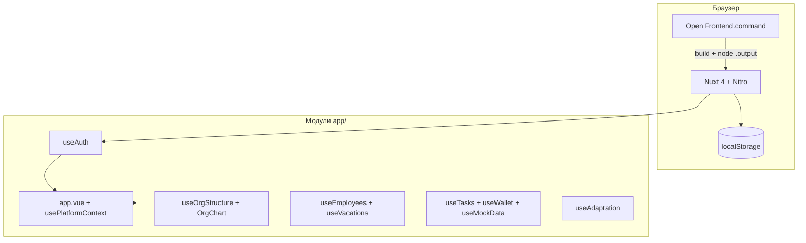

# Архитектура VIBE VBI

Бизнес-правила (что считается, этапы, остатки дней): **[PRODUCT.md](./PRODUCT.md)**.  
Идеи из обзора K-Team HRM → VBI: **[K-TEAM-MAP.md](./K-TEAM-MAP.md)**.  
Этот файл — карта кода, API и storage.

## Обзор



Приложение — **SPA с SSR**: сервер отдаёт HTML, интерактивность и персистентность на клиенте.

---

## Точка входа и оболочка

### `app/app.vue`

Порядок рендера:

1. `authReady === false` → «Загрузка...»
2. Не авторизован → `AuthLogin.vue`
3. Авторизован → `app-shell` (sidebar + topbar + `<NuxtPage />`) + опционально `FirstLoginOnboarding` (приветствие → аватар → конфетти)

### `usePlatformContext.ts`

- Роль UI: `employee` | `admin` (не путать с `user.role` в auth).
- Админ с `role: admin` может переключать режим в сайдбаре.
- `guardRoute`: пути `/admin/*` недоступны в режиме сотрудника.

### Поэтапный запуск (`useLaunchScope.ts`)

- Env: `NUXT_PUBLIC_LAUNCH_SCOPE` — `full` (по умолчанию) или `vacations`.
- В режиме `vacations`: сотрудник — `/vacations`; админ — переключатель в сайдбаре, разделы «График отпусков» и «Сотрудники» (даты выхода, руководитель = согласование).
- **Хардлок боя:** хост `45.12.74.25` без порта `:8080` всегда `vacations` (`utils/productionHost.ts`), даже если в бандле ошибочно `full` / `appEnv=development`.

### Окружения и деплой

- Env: `NUXT_PUBLIC_APP_ENV` — `development` | `staging` | `production` (`useAppEnv.ts`; на хосте боя принудительно `production`).
- Ветки Git: `staging` → тест, `main` → бой. Подробно: [DEPLOYMENT.md](DEPLOYMENT.md).
- CI: GitLab `.gitlab-ci.yml` (сборка + deploy на VPS); опционально GitHub Actions `ci.yml`, `release-artifact.yml`.
- Ручной бой: только `build-and-deploy.sh production`. Перед rsync — `verify-production-build.sh` (отказ, если нет `appEnv=production` + `launchScope=vacations`).
- На сервере: `deploy/systemd/`, `deploy/nginx/`, порты 3300 (бой) / 3301 (тест).
- **Данные на production/staging** — рабочие: `employees.json` merge (`merge-employees-seed.mjs`, сервер + overlay руководителей); `vacations.json` и `ideas.json` при деплое не перезаписываются, если файл уже на сервере.

### Битрикс24 (коробка)

- OAuth 2.0 локального приложения: `GET /api/auth/bitrix` → портал → `GET /api/auth/bitrix/callback`.
- Синк сотрудников при входе: `server/utils/bitrixSync.ts` → `server/data/employees.json`.
- Сессия: cookie `vbi-session`, `auth_source: 'bitrix'`, `id` = `bitrix_user_id`.
- Env (сервер): `BITRIX_PORTAL_URL`, `BITRIX_CLIENT_ID`, `BITRIX_CLIENT_SECRET` — см. [BITRIX.md](BITRIX.md).

### Плагины (только client)

| Файл | Назначение |
|------|------------|
| `auth.client.ts` | `restoreSession()` при старте |
| `vbi-demo-data.client.ts` | Миграция версии демо, `hydrate()` сотрудников, отпусков, оргструктуры |

---

## Composables

| Composable | Файл | Ответственность |
|------------|------|-----------------|
| `useAuth` | `useAuth.ts` | Логин, сессия, онбординг (welcome + аватар) |
| `useAvatars` | `useAvatars.ts` | Персонажи `public/avatars/`, выбор и URL по user id |
| `usePlatformContext` | `usePlatformContext.ts` | Навигация, режим admin/employee |
| `useLaunchScope` | `useLaunchScope.ts` | Поэтапный запуск (`vacations` / `full`) |
| `usePermissions` | `usePermissions.ts` | Подписи ролей, `roleLabel` |
| `useEmployees` | `useEmployees.ts` | Справочник ФИО, руководители, связь с аккаунтами |
| `useVacations` | `useVacations.ts` | Заявки, календарь, двухэтапное согласование Digital (`vacationApproval.ts`) |
| `useOrgStructure` | `useOrgStructure.ts` | Директора, отделы, группы, сетка |
| `useTasks` | `useTasks.ts` | Задачи геймификации |
| `useWallet` | `useWallet.ts` | Баланс и транзакции |
| `useMockData` | `useMockData.ts` | Демо-данные дашборда, магазин |
| `useAdaptation` | `useAdaptation.ts` | Трек адаптации, тесты, `$fetch` к Nitro API |
| `useProfileActivity` | `useProfileActivity.ts` | Лента «Недавняя активность» (сервер + авто) |
| `useAdminData` | `useAdminData.ts` | Справочники админки (пользователи, отделы legacy) |
| `useIdeasBank` | `useIdeasBank.ts` | Банк идей: список, голоса, создание, этапы, удаление |
| `useAdminNotifications` | `useAdminNotifications.ts` | Колокольчик admin/HR (в т.ч. `idea_submitted`, юбилеи) |

**Правило:** `useState()` только **внутри** функций composable / setup — не на уровне модуля (иначе SSR 500 и вечная «Загрузка...»).

---

## Страницы (`pages/`)

### Сотрудник

- `index.vue` — главная
- `adaptation.vue`
- `organization.vue` → `OrgChart` readonly
- `vacations.vue` — ветвление employee / manager UI
- `tasks.vue`, `store.vue`, `wallet.vue`, `profile/index.vue`
- `ideas/index.vue` — банк идей (сотрудник)

### Админ

- `admin/index.vue` — хаб ссылок
- `admin/organization.vue` — `OrgChart` + кнопки +директор / +отдел / +группа
- `admin/employees.vue` (сотрудники, аккаунты, подчинение), `admin/hierarchy.vue` (редирект → employees), `admin/vacations.vue`
- `admin/users.vue` (редирект → employees), `admin/store.vue`, `admin/adaptation.vue`
- `admin/activity.vue` — ручные события профиля («Недавняя активность»)
- `admin/ideas.vue` — банк идей: этапы, комментарии, удаление
- `profile` — личный профиль (пункт «Профиль» в меню и в режиме сотрудника, и в режиме админа)

---

## Банк идей

Продуктовые правила и этапы: **[PRODUCT.md](./PRODUCT.md)** §2.

Поток статусов (`IdeaStatus`):

```
review (На рассмотрении)
  ├─→ implementation (Реализация)
  │      └─→ done (Реализовано)  → учитывается в топ-авторах
  └─→ rejected (Отклонено)     → обязателен комментарий причины
```

| Кто | Что |
|-----|-----|
| Сотрудник | Создаёт идею → `review`; голосует; удаляет **свою**; получает уведомление (Vibe + Bitrix) при смене этапа |
| Admin / HR | `/admin/ideas`: смена этапа (модалка + комментарий), удаление любой |
| Система | После create — admin `idea_submitted`; после смены этапа — автору `idea_status_changed` + Bitrix |

Топ-авторы: только идеи со `status === 'done'`, подпись «N реализованных идей».

Данные: `server/data/ideas.json` (`ideas`, `nextIdeaId`, `votesByUserId`), очередь `mutateIdeas`. API: `GET/POST /api/ideas`, `POST /api/ideas/:id/vote`, `PATCH /api/ideas/:id/status`, `DELETE /api/ideas/:id`. При деплое файл не перезаписывается, если уже есть на сервере (как `vacations.json`). Уведомления admin — `server/data/admin-notifications.json`.

Legacy endpoints `POST /api/ideas/notify` и `POST /api/ideas/status-notify` остаются, но создание/статус шлют уведомления из server mutations.

---

## Ключевые компоненты

| Компонент | Назначение |
|-----------|------------|
| `OrgChart.vue` | Иерархическая оргсхема, drag на сетке 6 колонок |
| `OrgUnitFields.vue` | Поля отдела (название, руководитель) |
| `OrgConfirmDialog.vue` | Подтверждение удаления |
| `InlineField.vue` | Редактирование текста inline |
| `EmployeeVacationPanel.vue` | Кабинет сотрудника: заявки + календарь; `vac-year-chip` справа над календарём; годы `< primaryYear` — только просмотр |
| `ManagerVacationAside.vue` | Боковая панель руководителя |
| `VacationTeamCalendar.vue` | Команда на год |
| `VacationDetailedCalendar.vue` | Детальный календарь |
| `AuthLogin.vue` | Форма входа |
| `FirstLoginOnboarding.vue` | Первый вход: приветствие, выбор аватара, конфетти |
| `UserAvatar.vue` | Круглый аватар или инициалы |
| `AdaptationQuizForm.vue` | Прохождение теста, отправка на сервер |
| `AdaptationPhaseTimeline.vue` | Фазы трека, чеклист, CTA теста |

---

## Адаптация (Nitro API)

Серверные данные в `frontend/server/data/`:

| Файл | Содержимое |
|------|------------|
| `adaptation-track.json` | Шаблон трека и вопросы (с `correct` только на сервере) |
| `adaptation-state.json` | Попытки тестов и отметки шагов |
| `adaptation-scenarios.json` | Каталог сценариев адаптации (CRUD admin/HR) |
| `adaptation-assignments.json` | Назначения сценария сотруднику |
| `profile-activity.json` | Ручные/тестовые события «Недавняя активность» в профиле |
| `employees.json` | Справочник для привязки `platform_user_id` → ФИО |
| `employee-managers.json` | Назначения руководителей (overlay по `id`/ФИО); не перезаписывается импортом, деплоем и синком Bitrix |
| `admin-notifications.json` | Уведомления admin/hr о расхождениях ФИО/должности с Битрикс24 |

Cookie **`vbi-session`** (httpOnly) — при логине `POST /api/auth/session`.

| Endpoint | Назначение |
|----------|------------|
| `GET /api/adaptation/me` | Прогресс текущего пользователя |
| `GET /api/adaptation/scenarios` | Каталог сценариев + назначения (admin/HR) |
| `POST /api/adaptation/scenarios` | Создать сценарий |
| `PUT /api/adaptation/scenarios/:id` | Обновить сценарий |
| `DELETE /api/adaptation/scenarios/:id` | Удалить сценарий |
| `POST /api/adaptation/assign` | Назначить сценарий сотруднику |
| `POST /api/adaptation/attempts` | Сдача теста → запись для админа |
| `GET /api/adaptation/attempts` | Журнал (admin) или `?mine=1` |
| `PATCH /api/adaptation/attempts/:id/seen` | Админ отметил просмотр |
| `PATCH /api/adaptation/steps/:stepId` | Отметить шаг чеклиста |
| `GET /api/profile-activity` | Лента активности (`?employee_id` / `platform_user_id`) |
| `POST /api/profile-activity` | Ручная запись (admin/HR) |
| `DELETE /api/profile-activity/:id` | Удалить запись |

Клиент: `useAdaptation.ts`, `useProfileActivity.ts`.

### Справочник сотрудников (API)

| Endpoint | Назначение |
|----------|------------|
| `GET /api/employees` | Список (сессия) — источник для адаптации |
| `PUT /api/employees` | Сохранение справочника (admin/hr) |

Клиент: `useEmployees` — `localStorage` + синхронизация через `persist()` → `PUT`.

Сервер: `employeesStore.ts` + `employeeManagersStore.ts` — при чтении подмешивается `employee-managers.json`; при сохранении из админки overlay обновляется. Синк Bitrix (`writeEmployees` с `preserveManagers: true`) overlay не трогает.

### Заявки на отпуск (API)

| Endpoint | Назначение |
|----------|------------|
| `GET /api/vacations` | Полное состояние (`primaryYear`, `requestsByYear`, `nextRequestId`, `reservationsByYear`, `nextReservationId`) |
| `POST /api/vacations/requests` | Создать одну заявку (тело: `year`, `employee`, `start`, `end`, `comment?`) |
| `PATCH /api/vacations/requests/:id` | Изменить даты, статус, `approval_step` |
| `DELETE /api/vacations/requests/:id` | Удалить заявку |
| `POST /api/vacations/reservations` | Предварительная бронь: `year`, `month` (1–12), `durationDays`, `comment?` |
| `PATCH /api/vacations/reservation-caps` | Зарезервировано (лимиты фиксированы в коде: 5 на отдел, 1 в подгруппе); UI у руководителей убран |
| `DELETE /api/vacations/reservations/:id` | Удалить бронь (своя или admin) |

Сервер: `vacationsStore.ts` (`mutateVacations` — очередь правок), `vacationRequestMutations.ts`, `vacationReservationMutations.ts`; при финальном согласовании заявки — синк в Битрикс (`bitrixVacationAbsence.ts`). `PUT /api/vacations` отключён (410).

Клиент: `useVacations` — `GET` при входе, каждая правка через POST/PATCH/DELETE; `localStorage` `vbi-vacations-state-v6` — кэш (миграция с v5).

**Предварительная бронь** (`VacationReservation` в `vacationReservations.ts`): месяц + длительность без `start`/`end`; не влияет на баланс и approval; отображается полосатыми плашками; конвертация в заявку через «Уточнить даты» в `EmployeeVacationAside`.

**Лимиты броней** (`vacationReservationCaps.ts`, `vacationDepartmentGroups.ts`): для grouped-отделов (Digital) — пул на весь отдел (`digital-department`, по умолчанию 5 броней/мес., переопределяется в `reservationMonthlyCapsByGroup`) и не более 1 брони в месяц внутри подгруппы (`digital-tskhai`, `digital-popov`, …). Проверка на `POST /api/vacations/reservations` и в UI (`EmployeeYearCalendar` — серая `+бронь`). Демо QA использует тот же механизм только на localhost (`qa-department`).

**Пересечение отпусков групхедов** (`vacationGroupLeadOverlap.ts`): в Digital одновременно не более одного руководителя группы (type `lead` в `vacationDepartmentGroups`) в отпуске на пересекающиеся даты; проверка при создании/смене дат заявки и предупреждение в форме сотрудника.

### Уведомления пользователей (отпуска)

| Endpoint | Назначение |
|----------|------------|
| `GET /api/notifications` | Уведомления текущего пользователя по отпускам |
| `DELETE /api/notifications/:id` | Закрыть (удалить) уведомление |
| `PATCH /api/notifications/:id/seen` | Прочитано |
| `PATCH /api/notifications/seen-all` | Прочитать все |

Типы: руководителю — `vacation_submitted`, `vacation_updated`, `vacation_deleted` (при правке/удалении — manager + director отдела); сотруднику — `vacation_approved`, `vacation_rejected`, `vacation_next_stage`; автору идеи — `idea_status_changed` (платформа + Bitrix при смене этапа).

Хранение: до 100 уведомлений на получателя (FIFO); крестик в колокольчике → `hidden_from_bell` (запись остаётся на `/notifications`); `DELETE /api/notifications/:id` — полное удаление.

Параллельно в Битрикс (`bitrixVacationNotify.ts` / `ideaNotifications.ts`): `im.notify.system.add` через OAuth (колокольчик от системы); без токена — не шлём; чат только при `BITRIX_VACATION_NOTIFY_CHAT_FALLBACK=true` (для отпусков; для идей чат не используется).

Клиент: `VacationNotificationsBell.vue` (режим сотрудника), `pages/notifications.vue`. Админские Bitrix-уведомления — отдельно (`AdminNotificationsBell`, `/admin/notifications`).

Идеи: `GET/POST /api/ideas`, `POST /api/ideas/:id/vote`, `PATCH /api/ideas/:id/status`, `DELETE /api/ideas/:id` (очередь в `ideas.json`; notify встроен в mutations). Legacy: `POST /api/ideas/notify`, `POST /api/ideas/status-notify`.

### Аватары сотрудников (API)

| Endpoint | Назначение |
|----------|------------|
| `GET /api/avatars` | Все аватары `{ avatars: { [userId]: "character_01" } }` (сессия) |
| `PUT /api/avatars/me` | Сохранить свой аватар `{ characterId }` |

Сервер: `server/data/user-avatars.json`. Клиент: `useAvatars` + плагин `avatars.client.ts` (гидратация после входа). Локальный `vbi-user-avatars-v1` — кэш; при входе локальный аватар без записи на сервере подгружается автоматически.

### Уведомления администратора (Bitrix)

| Endpoint | Назначение |
|----------|------------|
| `GET /api/admin/notifications` | Список уведомлений, `unseen_count` |
| `PATCH /api/admin/notifications/:id/seen` | Отметить прочитанным |
| `PATCH /api/admin/notifications/seen-all` | Прочитать все |

Клиент: `useAdminNotifications.ts`, `AdminNotificationsBell.vue`, страница `/admin/notifications`.

Создание: `bitrixSync.ts` при расхождении `name`/`title` с Bitrix → `adminNotificationsStore.ts` (без авто-применения на платформе).

---


## Оргструктура (данные)

```ts
OrgExecutive   // id, title, person, order, gridCol, gridRow
OrgUnit        // отдел: executiveId, groupId?, name, head, ...
OrgUnitGroup   // рамка: label, executiveId, gridCol, gridRow
```

- `buildPlacedItems()` — порядок отрисовки: группы, затем solo-отделы.
- `snapGridCell()` — привязка drag к ячейкам.
- Storage: **`vbi-org-structure-v1`**.

---

## Отпуска

Продуктовые правила (формулы дней и баланса, этапы согласования, бронь): **[PRODUCT.md](./PRODUCT.md)** §1.

1. `useEmployees` — кто чей руководитель; `findByUserForAuth()` по `platform_user_id` или email.
2. `useVacations` — заявки, статусы, `canManagerApproveRequest()`, `formatMonthVacationRange()` (даты в месячной таблице: `DD.MM-DD.MM`).
3. `utils/vacationBalance.ts` — баланс ЗУП, аванс (`assessVacationBalance`), колонки **Отгулял** / **План** (`calcEmployeeBalance`: будущие согласованные → план, прошедшие/текущие → отгулял).
4. `utils/vacationCalendar.ts` — праздники РФ, `countVacationBillableDays` (праздники не входят в счёт).
5. Сид: `data/vacation-seed.json` (год, праздники, демо-заявки).

**UI-плашки (ITMO pill):** solid фон, белый жирный текст, без обводки. CSS-токены в `main.css`:

| Токен | Назначение | Цвет |
|-------|------------|------|
| `--vac-pill-approved-bg` | Согласован (таблица, «Мои заявки») | `#388073` |
| `--vac-pill-pending-bg` | На согласовании (месячная таблица) | `#d4a03a` |
| `--vac-pill-overlap-bg` | Пересечение отпусков | `#efc038` |
| `--vac-pill-advance-bg` | Аванс | `#e186a9` |
| `--vac-pill-rejected-bg` | Отклонён | `#c44b5a` |

Классы: `.vac-block` (месячный календарь), `.vac-overlap-badge`, `.vac-advance-badge`, `.emp-request-meta .pill`. Popover пересечений и аванса — Teleport + ромбик `::before`.

**Режимы UI на `/vacations`:** сотрудник — `EmployeeVacationPanel` + `EmployeeVacationAside`. У сотрудников с командным календарём — вкладки «Мой календарь / Общий» (`VacationCalendarScopeToggle`, `useEmployeeVacationTeamView`, `vacationTeamScope.ts`); «Общий» — `VacationTeamCalendar` variant `employee-team` (в т.ч. весь отдел DEV для сотрудников без права согласования). Руководитель/HR — `ManagerVacationAside`: переключатель «Режим» (slide toggle) всегда сверху; в режиме «Сотрудник» под ним тот же `EmployeeVacationAside`, что у сотрудника; в режиме «Руководитель» — статистика команды и блок обучалки `ManagerVacationTrainingPrompt` под «Заявки».

**Обучалки отпусков:** сотрудник — `useVacationTraining` + `VacationTrainingPrompt/Overlay`; руководитель — `useManagerVacationTraining` + `ManagerVacationTrainingPrompt/Overlay`. Для роли руководителя ачивка «Календарь отпусков» выдаётся только после завершения обоих квестов.

Референс бизнес-логики: `_vacation_source/График отпусков/`.

### Учётный год и переход 31.12 → 01.01

| Поле | Назначение |
|------|------------|
| `vacations.primaryYear` | Учётный год ЗУП: база `vacation_opening_balance` — остаток на 1 января этого года |
| `viewYear` (UI) | Год календаря и бакета `requestsByYear`. У сотрудника годы раньше `primaryYear` — read-only. **Не** влияет на формулу баланса и таблицу «Отгулял / план» (aside всегда `primaryYear`) |
| `employee.vacation_opening_balance` | Остаток на 01.01 `primaryYear` (из Excel или после rollover) |

**Переход на новый год:** остаток на 31.12.N (`calcAvailableOnDate` с учётом всех заявок до конца года) записывается в `vacation_opening_balance` каждого сотрудника; `primaryYear` → N+1.

- Код: `server/utils/vacationYearRollover.ts`
- CLI: `node scripts/rollover-vacation-year.mjs 2026 2027` (cwd: `frontend/`)
- API: `POST /api/admin/vacations/rollover` `{ fromYear, toYear }` (admin/hr)

---

## localStorage

| Ключ | Composable / модуль |
|------|---------------------|
| `vbi-auth-session` | `useAuth` |
| `vbi-welcomed-users` | `useAuth` (IDs, завершивших онбординг) |
| `vbi-user-avatars-v1` | `useAvatars` — локальный кэш; источник правды `server/data/user-avatars.json`, API `/api/avatars` |
| `vbi-platform-demo-version` | `vbi-demo-data.client.ts` (сейчас `4`) |
| `vbi-employees-v3` | `useEmployees` |
| `vbi-vacations-state-v6` | `useVacations` (заявки + предварительные брони; миграция с v5) |
| `vbi-employee-vac-calendar-scope-v1` | `useEmployeeVacationTeamView` — «Мой календарь» / «Общий» |
| `vbi-vac-show-title-col-v1` | `VacationTeamCalendar` — показать столбец «Должность» (`1`/`0`) |
| `vbi-org-structure-v1` | `useOrgStructure` |
| `vbi-tasks-state` | `useTasks` |
| `vbi-wallet-state-v1` | `useWallet` — транзакции валюты (в т.ч. юбилеи стажа `tenure-milestone-{userId}-{N}y`) |

Идеи: сервер `server/data/ideas.json` (не localStorage). Устаревшие ключи `vbi-ideas-bank-v2` / `vbi-ideas-votes-v1-*` больше не используются.

Устаревшие ключи сбрасываются при смене `DEMO_PLATFORM_VERSION` (см. `LEGACY_STORAGE_KEYS` в плагине).

**Юбилеи стажа:** при `bootstrapAppData` — `applyTenureMilestoneRewards()` (5/10/15/20 лет по `hired_at`). Суммы: `TENURE_MILESTONE_AMOUNTS` в `utils/tenureMilestones.ts` (`null` = ещё не задано).

---

## Стили

- Единый файл: `app/assets/main.css` (~5700 строк).
- Токены: neo-brutalist light UI (`--page-bg`, `--border-brutal`), фиолетовый topbar (`--hero-purple`), лайм (`--accent-lime`), vacation-pill (см. раздел «Отпуска»).
- `platform-base.css` — **не используется** в сборке (остаток эксперимента Miro); можно удалить при уборке.

Подключение: `nuxt.config.ts` → `css: ['~/assets/main.css']`.

---

## Сборка и запуск

```
npm run build  →  frontend/.output/server/index.mjs
NITRO_PORT=3300 NITRO_HOST=127.0.0.1 node .output/server/index.mjs
```

`Open Frontend.command` освобождает порты 3000/3300, собирает и открывает браузер.

---

## Backend

- **Адаптация и сессия** — реализованы в Nitro (`frontend/server/`).
- Папка `backend/` зарезервирована для выноса wallet/tasks/store при необходимости.

---

## Известные ограничения демо

- Нет реальной аутентификации (пароли в коде).
- Данные локальны браузеру.
- Роли `hr` в auth есть, но UI в основном `employee` / `admin` + manager для отпусков.
- `useMockData` и `useTasks` частично дублируют типы с `useWallet` (warning Nuxt duplicated imports — не критично).
