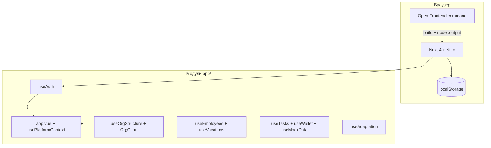

# Архитектура VIBE VBI

Бизнес-правила (что считается, этапы, остатки дней): **[PRODUCT.md](./PRODUCT.md)**.  
Идеи из обзора K-Team HRM → VBI: **[K-TEAM-MAP.md](./K-TEAM-MAP.md)**.  
Этот файл — карта кода, API и storage.

## Обзор



Приложение — **SPA с SSR**: сервер отдаёт HTML, интерактивность и персистентность на клиенте.

---

## Точка входа и оболочка

### `app/app.vue`

Порядок рендера:

0. Путь начинается с `/s/` (публичная страница опроса, `isBareRoute`) → **только** `<NuxtPage />`, без логина/sidebar/topbar/футера/оверлеев — respondent не обязан иметь Vibe-сессию и не должен увидеть ничего, что выдаёт платформу
1. `authReady === false` → «Загрузка...»
2. Не авторизован → `AuthLogin.vue`
3. Авторизован → `app-shell` (sidebar + topbar + `<NuxtPage />`) + опционально `FirstLoginOnboarding` (приветствие → аватар → конфетти)

### `usePlatformContext.ts`

- Роль UI: `employee` | `admin` (не путать с `user.role` в auth).
- Админ с `role: admin` может переключать режим в сайдбаре.
- `guardRoute`: пути `/admin/*` недоступны в режиме сотрудника.

### Поэтапный запуск (`useLaunchScope.ts`)

- Env: `NUXT_PUBLIC_LAUNCH_SCOPE` — `full` (по умолчанию) или `vacations`.
- В режиме `vacations`: сотрудник — `/vacations`; админ — переключатель в сайдбаре. Whitelist боя: отпуска, уведомления, профиль, идеи, **база знаний** (`/knowledge`, `/admin/knowledge`), сотрудники, оргструктура админки. С замком: VPN, «Как выглядит».
- **Хардлок боя:** хост `45.12.74.25` без порта `:8080` всегда `vacations` (`utils/productionHost.ts`), даже если в бандле ошибочно `full` / `appEnv=development`.

### Окружения и деплой

- Env: `NUXT_PUBLIC_APP_ENV` — `development` | `staging` | `production` (`useAppEnv.ts`; на хосте боя принудительно `production`).
- Ветки Git: `staging` → тест, `main` → бой. Подробно: [DEPLOYMENT.md](DEPLOYMENT.md).
- CI: GitLab `.gitlab-ci.yml` (сборка + deploy на VPS); опционально GitHub Actions `ci.yml`, `release-artifact.yml`.
- Ручной бой: только `build-and-deploy.sh production`. Перед rsync — `verify-production-build.sh` (отказ, если нет `appEnv=production` + `launchScope=vacations`).
- Клиентские ассеты `public/_nuxt`: при деплое **без** `--delete` (Вебвизор тянет CSS по старым URL ~15 суток); файлы старше 20 дней чистятся.
- На сервере: `deploy/systemd/`, `deploy/nginx/`, порты 3300 (бой) / 3301 (тест).
- **Данные на production/staging** — рабочие: `employees.json` merge (`merge-employees-seed.mjs`, сервер + overlay руководителей); `vacations.json` и `ideas.json` при деплое не перезаписываются, если файл уже на сервере.
- **Бэкап отпусков:** еженедельный снапшот `vacations.json` → `server/data/backups/vacations/` (`vbi-hr-vacations-backup.timer`, 12 копий). Скрипт `deploy/scripts/run-vacations-backup.sh` (копия файла, без HTTP).
- **Памятка после отпуска:** `PostVacationMemo.vue` в `app.vue`; правило в `postVacationMemo.ts`; ключ `vbi-post-vacation-memo-v2`. UI Design C: lavender card + folder-tabs 1–5 (декор) + арт `/memos/pvm-c-art-*.png` (без текста). Welcome → **Прочитать** сразу в совет 1; **Позже** → чип 10 рабочих дней → карусель с вводной «Вот четыре совета», затем 4 совета. Превью `?pvm=1`; повтор из уведомлений `?pvm=tips`. Уведомление `post_vacation_memo` (`POST /api/notifications/post-vacation-memo`). Пока памятка жива, занимает слот `useBottomRightSlot` — кот оценки не выезжает.
- **Кот оценки:** `PageRateCatHost` + `KnowledgeRateCat`; не монтируется, если `useBottomRightSlot().isOccupied`.

### Битрикс24 (коробка)

- OAuth 2.0 локального приложения: `GET /api/auth/bitrix` → портал → `GET /api/auth/bitrix/callback`.
- Вход разрешён **только** если Bitrix user id есть в `employees.json`; иначе 403 (экстранет/гости).
- Синк при входе: `bitrixSync.ts` → обновляет уже заведённых, `importNew` по умолчанию **false**.
- День рождения: `user.get` select `PERSONAL_BIRTHDAY` → `normalizeBitrixBirthday` (`server/utils/bitrixBirthday.ts`) → поле `birthday` сотрудника (колонка `employees.birthday` в Postgres, `YYYY-MM-DD` или `MM-DD`; Bitrix перезаписывает, пусто → `null`). Визитка: `formatBirthdayCard` / `isBirthdayToday` в `app/utils/tenureAnniversary.ts`.
- Сессия: подписанная cookie (`sessionToken.ts`), TTL 8ч, Secure на staging/prod, sliding refresh в `requireVbiSession`.
- Сессия: cookie `vbi-session`, `auth_source: 'bitrix'`, `id` = `bitrix_user_id`.
- Env (сервер): `BITRIX_PORTAL_URL`, `BITRIX_CLIENT_ID`, `BITRIX_CLIENT_SECRET` — см. [BITRIX.md](BITRIX.md).

### Плагины (только client)

| Файл | Назначение |
|------|------------|
| `auth.client.ts` | `restoreSession()` при старте |
| `vbi-demo-data.client.ts` | Миграция версии демо, `hydrate()` сотрудников, отпусков, оргструктуры |

---

## Composables

| Composable | Файл | Ответственность |
|------------|------|-----------------|
| `useAuth` | `useAuth.ts` | Логин, сессия, онбординг (welcome + аватар) |
| `useAvatars` | `useAvatars.ts` | Персонажи `public/avatars/`, выбор и URL по user id |
| `usePlatformContext` | `usePlatformContext.ts` | Навигация, режим admin/employee |
| `useLaunchScope` | `useLaunchScope.ts` | Поэтапный запуск (`vacations` / `full`) |
| `usePermissions` | `usePermissions.ts` | Подписи ролей, `roleLabel` |
| `useEmployees` | `useEmployees.ts` | Справочник ФИО, руководители, связь с аккаунтами |
| `useEmployeeVisitingCard` | `useEmployeeVisitingCard.ts` | Публичная визитка у клика (команда в профиле, идеи; не календарь отпусков; структура — позже) |
| `useVacations` | `useVacations.ts` | Заявки, календарь, двухэтапное согласование Digital (`vacationApproval.ts`) |
| `useManagerVacationMode` | `useManagerVacationMode.ts` | Режим отпусков руководителя/HR `manager` / `employee` (`useState('vac-manager-ui-mode')`): тумблер в aside и «Я · Руководитель» в мобильной шапке |
| `useOrgStructure` | `useOrgStructure.ts` | Директора, отделы, группы, сетка |
| `useTasks` | `useTasks.ts` | Задачи геймификации |
| `useWallet` | `useWallet.ts` | Баланс и транзакции |
| `useMockData` | `useMockData.ts` | Демо-данные дашборда, магазин |
| `useAdaptation` | `useAdaptation.ts` | Трек адаптации, тесты, `$fetch` к Nitro API |
| `useProfileActivity` | `useProfileActivity.ts` | Лента «Недавняя активность» (сервер + авто) |
| `useAdminData` | `useAdminData.ts` | Справочники админки (пользователи, отделы legacy) |
| `useIdeasBank` | `useIdeasBank.ts` | Банк идей: список, голоса, создание, этапы, удаление |
| `useAdminNotifications` | `useAdminNotifications.ts` | Колокольчик admin/HR (в т.ч. `idea_submitted`, юбилеи) |
| `useAdminSurveys` | `useAdminSurveys.ts` | Опросы (админ): список, создание, конструктор, публикация, результаты |
| `useSurveyRespond` | `useSurveyRespond.ts` | Публичная страница `/s/:slug`: загрузка опроса, отправка ответа — без auth-состояния |

**Правило:** `useState()` только **внутри** функций composable / setup — не на уровне модуля (иначе SSR 500 и вечная «Загрузка...»).

---

## Страницы (`pages/`)

### Сотрудник

- `index.vue` — главная
- `adaptation.vue`
- `organization.vue` → `OrgChart` readonly + панель сотрудников; продуктовые правила **[PRODUCT.md](./PRODUCT.md)** §8
- `vacations.vue` — employee UI или `VacationsManagerExperience` (manager/hr)
- `tasks.vue`, `store.vue`, `wallet.vue`, `profile/index.vue`
- `ideas/index.vue` — банк идей (сотрудник)
- `event/pit-stop/` — **удалено 2026-10-20** (ивент Pit Stop 14 закрыт). Редирект `/event/pit-stop/**` и `/admin/quest-dashboard` → `/` в `nuxt.config.ts` (`routeRules`). От ивента осталось: модуль `app/events/pit-stop-14/` (только `types`/`copy`/`timeline`/`trackDrive`/`rewards` — нужны сторам), сторы `pitStopStore.ts` / `pitStopRaceStore.ts` (данные, `db-migrate`, `db-health`, тесты этапа 8) и ачивка `pit-stop-14`: `usePitStopWinners` → `GET /api/achievements/pit-stop-14-winners` (`ensureRaceFinalized`, топ‑3) → `useAchievements` и визитка (`employeePublicCard`).
- `knowledge/index.vue` — поиск / чат ИИ; FAB «написать» слева внизу → `/knowledge/write` (`KnowledgeArticleWorkspace.vue`: редактор как у админа + свои статьи / команда / ревью). `knowledge/[id].vue` — статья. Сид `data/knowledgeBaseCatalog.ts`. Поиск: `utils/knowledgeSearch.ts` (стоп-слова `KNOWLEDGE_STOP_WORDS`, индекс основа → статьи в `WeakMap` на список статей: строится один раз, дальше поиск ~0,2 мс на 194 статьях), `useKnowledgeSearch` (`stopWordsOnly` для подсказки). Стеммер `utils/ruStem.ts` (`stemRu`) общий с RAG: `server/utils/knowledgeRagLexical.ts` импортирует и реэкспортирует его. ИИ: `useKnowledgeAiAnswer` + `POST /api/knowledge/yandex-ask`, `useKnowledgeAiChat`. Оценка страницы: `POST /api/knowledge/feedback` → админ-уведомление `page_feedback` + imbot Драго. Подсказки: `knowledgeSearchPhrases.ts`.
- Статьи сотрудников: страница `/knowledge/write`; `useKnowledgeAuthor` + API `GET/POST /api/knowledge/articles`, `PATCH …/:id`, `POST …/submit|moderate|comments`. Модель: `authorUserId`, `comments[]`, `pendingRevision`, статусы `draft|pending_review|published|revision_requested|rejected`. Notify: `knowledgeNotifications.ts` → `createUserNotification` + `notifyBitrixSystemUser` (как отпуска/идеи); bell link → `/knowledge/write`.
- Картинки статей: HTML `src="/knowledge/article-{bitrixId}/…"` → файлы в `frontend/public/knowledge/article-*/` **обязательно в git** вместе с `server/data/knowledge-articles.json`. Деплой: `merge-knowledge-articles-seed.mjs` не затирает админские правки целиком, но обновляет `body`/`coverImage`, если сид несёт локальные `/knowledge/article-…`, на сервере остался Bitrix-chrome `/devs/asset/`, или `body` на сервере экранирован (`&lt;a` / `&lt;br` — артефакт старого markdown-детекта в WYSIWYG). Платформенные статьи Vibe (`kb-vibe-vacations-digital`, `kb-vibe-vacations-other`, `kb-vibe-ideas`) и кейсы ecom (`kb-case-ecom-*`, `kb-case-ecom-index`; MD в `docs/knowledge-cases/ecom/`) всегда берутся из сида; retired id (`kb-vibe-vacations`) с целевого файла снимается. Тела без блочных тегов нормализуются в `knowledgeArticleHtml.ts` (decode + обёртка `<div>`). Перенос из Bitrix: `scripts/bitrix/scrape-devs-articles.mjs` → `migrate-devs-to-knowledge.mjs` (временные HTML в `scripts/bitrix/tmp/`, в git не кладём).
- **RAG (поиск по смыслу) для «Спросить ИИ»:** эмбеддинги Yandex (`text-search-doc` / `text-search-query`) + гибрид со словесным score + осторожная переформулировка (`knowledgeRagRewrite.ts`, `knowledgeRagLexical.ts`). HTML → plain **с сохранением строк** (`stripHtml`), иначе шапки секций «Контактов» не детектятся. Длинные статьи режутся по underscore-разделителям и шапкам блоков (Programmatic, юристы, дизайнеры, Яндекс, переводы, UTM/коллтрекинг, акты YDirect/VKR, списания AFINA, разделы DayOFFF…). Якорь секции Контактов → только `kb-20409`; UTM → `kb-23420`; акты РП → `kb-31980`; списания → `kb-28468`. Индекс `server/data/knowledge-rag-index.json` (не в git, `INDEX_VERSION=6`). Endpoint `POST /api/knowledge/yandex-ask` сам подбирает фрагменты; `expandQuestionFromHistory` / `knowledgeAiIntent` склеивают уточнения («ещё другие», «это все?») с прошлым вопросом; guard против ложного OFFTOPIC при живом контексте. Вопросы про руководителей/отделы — `knowledgeOrgAnswer.ts` из `org-structure.json` + цитата «Структура». Пересборка: мутации статей, `POST /api/admin/knowledge/rag-reindex`, cron `knowledge-rag-reindex`. Eval: `POST /api/admin/knowledge/rag-eval`, кейсы `knowledgeRagEvalCases.ts`; локально `scripts/knowledge/check-rag-contacts.mjs`, `check-rag-access-utm.mjs`, `check-rag-dayoff-acts-writeoffs.mjs`, `check-kb-dialog-followup.mjs`, `check-kb-cases-fallback.mjs`, `check-kb-auto-avito.mjs`.

### Админ

- `admin/index.vue` — хаб ссылок
- `admin/organization.vue` — `OrgChart` + кнопки +директор / +отдел / +группа; данные `GET/PUT /api/org-structure` → `server/data/org-structure.json`
- `admin/employees.vue` (сотрудники, аккаунты, подчинение), `admin/hierarchy.vue` (редирект → employees), `admin/vacations.vue` (календарь + очередь согласования)
- `admin/how-it-looks.vue` — превью как у руководителя; на бое с замком после выката рук-ам
- `admin/users.vue` (редирект → employees), `admin/store.vue`, `admin/adaptation.vue`
- `admin/knowledge.vue` — редактор базы знаний (создать/редактировать/удалить/модерировать, WYSIWYG). Компонент `KnowledgeWysiwygEditor.vue`. Тело — HTML. Статусы: `draft` \| `pending_review` \| `published` \| `revision_requested` \| `rejected` (legacy `review` → `pending_review`). API: `GET/POST /api/admin/knowledge`, `PATCH/DELETE /api/admin/knowledge/:id` (в т.ч. `moderateAction`) → `server/data/knowledge-articles.json` (на стейдже схема `knowledge` в Postgres, см. «База данных → Этап 7»)
- `admin/activity.vue` — ручные события профиля («Недавняя активность»)
- `admin/ideas.vue` — банк идей: этапы, комментарии, удаление
- `admin/surveys/index.vue`, `admin/surveys/[id]/index.vue`, `admin/surveys/[id]/results.vue` — опросы: список / конструктор / результаты. Подробно — раздел «Опросы» ниже
- `event/nokturn/` — квест **«Синий Ноктюрн»** (26–30.10.2026). Модуль `app/events/nokturn/` (`types.ts`, `timeline.ts` — расписание и ставки, `content.ts` — весь контент пяти дней). **`content.ts` импортирует только серверный код:** страница получает этапы из `/api/event/nokturn/state`, и закрытый этап приходит без брифа, улик, показаний и координат мини-игры — иначе улики пятницы лежали бы в клиентском бандле с понедельника. Компоненты `app/components/nokturn/` (`NokturnBoard` — доска + сейф + перетаскивание + нити, `NokturnEvidenceCard`, `NokturnMinigameButton`, `NokturnSearchGame`, `NokturnBallot`, `NokturnBriefing`, `NokturnReveal`). API `/api/event/nokturn/*`: `state.get`, `board.post`, `vote.post`, `mechanics.post`, `badge.get` (точка в меню), `minigame/{start,solve,fail,release}.post`. Сервер: `nokturnStore.ts` (JSON `server/data/nokturn.json` через `writeJsonAtomic` + `createMutationQueue`), `nokturnGate.ts` (расписание, календарь догоняющего, правильные ответы — только на сервере), `nokturnClock.ts` (`NOKTURN_DEV_NOW` для прогона дней на localhost/стейдже), `nokturnRequest.ts`. Координаты улик и нитей — доли доски (0..1), пересчёт через `getBoundingClientRect()`, поэтому не ломаются под `--platform-zoom`. Полный экран — `Teleport` в `body` + `position: fixed` (не Fullscreen API), чтобы доска вышла из-под масштаба платформы; состояние в `localStorage` `vbi-nokturn-fullscreen`. Картинки — канонические пути `public/events/nokturn/` из `docs/quests/sinij-nokturn-art.md`.
- `event/ogonek/` — новогодний адвент **«Огонёк 2027»** (01–25.12.2026, 19 рабочих дней) и **Ёлка желаний** (`event/ogonek/tree.vue`). Дизайн — прототип `ogonek-advent-prototype.html`: отрывной календарь, гирлянда-прогресс, день раскрывается из листка на всю сцену. Модуль `app/events/ogonek/`: `palette.ts` (6 семейств по 2-3 тона + контур), `sprites.ts` (весь арт — сетки пикселей: 19 объектов 32×32 в трёх тонах, ёлка и камин 64×64, язычок огня, гирлянда, вилка), `timeline.ts`, `content.ts` (тексты 19 окон, звания), `sun.ts` (восход и заход для Москвы на листке), `snowflake.ts` (четверть 5×5 → рисунок 9×9), `dresscode.ts` (образы окна 8; отдельно от `content.ts`, чтобы тексты окон не попали в клиентский бандл), `treePlacement.ts`, `types.ts`. Спрайт рисуется на canvas один к одному и отдаётся data-URL (`app/utils/ogonekRender.ts`). Компоненты `app/components/ogonek/`: `OgonekSheet` (листок + отрыв), `OgonekGarlandBar` (огонёк на окно, «пуф»), `OgonekSnowField` (снег над календарём с подписями авторов; слой сквозной, подсказка по координатам курсора), `OgonekWindowContent` (действие окна по `kind`), `OgonekPixelGrid`, `OgonekPalettePicker`, `OgonekPlugSocket` (вилка и провод-верёвка на canvas), `OgonekMerchReveal` (окно 3: ковёр ткётся и оказывается на футболке), `OgonekTree`, `OgonekFeed`, `OgonekAwaiting`, `OgonekDecorLayer`, `OgonekFireplace`. API `/api/event/ogonek/*`: `state.get`, `open.post`, `submit.post` (все действия окон + `complete` + `devReset`), `tree.get`, `feed.get`, `decor.get`. Сервер: `ogonekClock.ts` (**часы запроса** `{ now, debugAllOpen, devDay }`: env `OGONEK_DEBUG_ALL_OPEN` / `OGONEK_DEV_NOW` и cookie `ogonek-dev-day`, на бою всё игнорируется), `ogonekGate.ts` (единственное место, где решается, открыто окно или нет; получает часы, а не читает env сам), `ogonekStore.ts` (JSON `server/data/ogonek.json`; у игрока `opened` и `done`), `ogonekDemo.ts` (демо для показа, гейт по `appEnv`, в файл не пишется). Токены дизайна — `.og-theme` в `main.css` (нужны и ёлке, и всему, что вынесено Teleport'ом). Раскрытый день, снег и тосты — `Teleport` в `body`, чтобы выйти из-под `--platform-zoom`. Гирлянда липнет под шапкой платформы: страница меряет высоту видимой шапки (`.topbar` / `.mob-top`) и отдаёт её в `--og-sticky-top`.
- `profile` — личный профиль (пункт «Профиль» в меню и в режиме сотрудника, и в режиме админа)

---

## Банк идей

Продуктовые правила и этапы: **[PRODUCT.md](./PRODUCT.md)** §2.

Поток статусов (`IdeaStatus`):

```
review (На рассмотрении)
  ├─→ implementation (Реализация)
  │      └─→ done (Реализовано)  → учитывается в топ-авторах
  └─→ rejected (Отклонено)     → обязателен комментарий причины
```

| Кто | Что |
|-----|-----|
| Сотрудник | Создаёт идею → `review`; голосует; удаляет **свою**; получает уведомление (Vibe + Bitrix) при смене этапа |
| Admin / HR | `/admin/ideas`: смена этапа (модалка + комментарий), удаление любой |
| Система | После create — admin `idea_submitted`; после смены этапа — автору `idea_status_changed` + Bitrix |

Топ-авторы: только идеи со `status === 'done'`, подпись «N реализованных идей».

Данные: `server/data/ideas.json` (`ideas`, `nextIdeaId`, `votesByUserId`; на стейдже схема `ideas` в Postgres, см. «База данных → Этап 7»), вложения `server/data/idea-attachments/{ideaId}/`, очередь `mutateIdeas`. API: `GET/POST /api/ideas`, `GET/POST /api/ideas/:id/file`, `POST /api/ideas/:id/vote`, `PATCH /api/ideas/:id/status`, `DELETE /api/ideas/:id`. При деплое файл не перезаписывается, если уже есть на сервере (как `vacations.json`). Уведомления admin — `server/data/admin-notifications.json` (идемпотентность по ключу события, `admin_seen` не сбрасывается при повторном синке). На production демо-сид идей не подмешиваем; word-filter по «тест/qa» в ФИО не используем (`getDeployAppEnv` + `ideas/index.get`).

Legacy endpoints `POST /api/ideas/notify` и `POST /api/ideas/status-notify` остаются, но создание/статус шлют уведомления из server mutations.

---

## Опросы

Продуктовые правила: **[PRODUCT.md](./PRODUCT.md)** §10b. Phase 1 — MVP.

- **Типы данных**: `frontend/app/composables/useSurveys.ts` (`Survey`, `SurveyQuestion`, `SurveyResponse`, 9 `SurveyQuestionType`) — общий файл, используется и на клиенте, и на сервере (как `useIdeasBank.ts` для идей).
- **Данные**: `server/data/surveys.json` (`surveys[]`, `nextSurveyId`), `server/data/survey-responses.json` (`responses: Record<surveyId, SurveyResponse[]>`). Чтение/запись/мутации — `server/utils/surveysStore.ts`, `surveyResponsesStore.ts` (atomic JSON + очередь мутаций, тот же паттерн, что `ideasStore.ts`; на стейдже схема `surveys` в Postgres, см. «База данных → Этап 8»). Валидация ответа на сервере — `surveyValidation.ts` (обязательные поля, допустимые опции/диапазоны — клиенту не доверяем). Агрегация результатов — `surveyResults.ts` (воронка + распределения по вопросу). Rate-limit публичной отправки — `simpleRateLimit.ts` (in-memory по IP, 20/мин).
- **Admin API** (`requireRole(['admin','hr'])`): `GET/POST /api/surveys`, `GET/PATCH/DELETE /api/surveys/:id`, `POST /api/surveys/:id/publish`, `POST /api/surveys/:id/unpublish` (→ `closed`, не `draft` — опрос мог уже собирать ответы), `GET /api/surveys/:id/results`.
- **Публичные API** (без `requireVbiSession`): `GET /api/public/surveys/:slug` (только для `status: published`, отдаёт только `PublicSurvey` — без `id`/`createdBy`/статуса), `POST /api/public/surveys/:slug/submit`.
- **Анонимность**: если `survey.anonymous === true`, `submit.post.ts` вообще не вызывает `getVbiSession` для привязки — поле `respondent` не попадает в объект ответа ни при каких условиях. Для неанонимных опросов `respondent` подставляется только если у отправителя была валидная Vibe-сессия (анонимный посетитель с улицы в неанонимном опросе просто не имеет `respondent`).
- **Публичная страница** `/s/[slug]` (`app/pages/s/[slug].vue`) рендерится в обход app-shell — см. «Точка входа и оболочка» (`isBareRoute` в `app.vue`). Собственная нейтральная вёрстка (не брендированная), composable `useSurveyRespond.ts`.
- **Админ-страницы**: `admin/surveys/index.vue` (список), `admin/surveys/[id]/index.vue` (конструктор — редактирование вопросов, reorder, анонимность, публикация), `admin/surveys/[id]/results.vue` (воронка + графики/список ответов, по конвенциям skill `dataviz`). Пункт меню «Опросы» — `usePlatformContext.ts` (`adminNav`).
  - **Важно про роутинг**: `[id]/index.vue` + `[id]/results.vue` как папка — не `[id].vue` файл рядом с папкой `[id]/`. Nuxt не рендерит вложенные маршруты под файлом с тем же динамическим именем без `<NuxtPage />` в родителе — тестировано вживую, при коллизии `/admin/surveys/:id/results` молча рендерил контент `[id].vue`.

---

## Ключевые компоненты

| Компонент | Назначение |
|-----------|------------|
| `OrgChart.vue` | Оргсхема: readonly contain без скролла; при roster — `layoutCompressX` (только X); edit — drag/связи |
| `OrgUnitRosterAside.vue` | Правая панель: заголовок + скролл списка сотрудников |
| `OrgUnitFields.vue` | Поля отдела (название, руководитель из справочника) |
| `OrgConfirmDialog.vue` | Подтверждение удаления |
| `InlineField.vue` | Редактирование текста inline |
| `EmployeeVacationPanel.vue` | Кабинет сотрудника: заявки + календарь; `vac-year-chip` справа над календарём; годы `< primaryYear` — только просмотр |
| `ManagerVacationAside.vue` | Боковая панель руководителя |
| `VacationTeamCalendar.vue` | Команда на год |
| `VacationDetailedCalendar.vue` | Детальный календарь |
| `AuthLogin.vue` | Форма входа |
| `FirstLoginOnboarding.vue` | Первый вход: приветствие, выбор аватара, конфетти |
| `UserAvatar.vue` | Круглый аватар или инициалы |
| `AdaptationQuizForm.vue` | Прохождение теста, отправка на сервер |
| `AdaptationPhaseTimeline.vue` | Фазы трека, чеклист, CTA теста |

---

## Адаптация (Nitro API)

Серверные данные в `frontend/server/data/`:

| Файл | Содержимое |
|------|------------|
| `adaptation-track.json` | Шаблон трека и вопросы (с `correct` только на сервере) |
| `adaptation-state.json` | Попытки тестов и отметки шагов |
| `adaptation-scenarios.json` | Каталог сценариев адаптации (CRUD admin/HR) |
| `adaptation-assignments.json` | Назначения сценария сотруднику |
| `profile-activity.json` | Ручные/тестовые события «Недавняя активность» в профиле |
| `employees.json` | Справочник для привязки `platform_user_id` → ФИО |
| `employee-managers.json` | Назначения руководителей (overlay по `id`/ФИО); не перезаписывается импортом, деплоем и синком Bitrix |
| `admin-notifications.json` | Уведомления admin/hr о расхождениях ФИО/должности с Битрикс24 |

Cookie **`vbi-session`** (httpOnly) — при логине `POST /api/auth/session`.

| Endpoint | Назначение |
|----------|------------|
| `GET /api/adaptation/me` | Прогресс текущего пользователя |
| `GET /api/adaptation/scenarios` | Каталог сценариев + назначения (admin/HR) |
| `POST /api/adaptation/scenarios` | Создать сценарий |
| `PUT /api/adaptation/scenarios/:id` | Обновить сценарий |
| `DELETE /api/adaptation/scenarios/:id` | Удалить сценарий |
| `POST /api/adaptation/assign` | Назначить сценарий сотруднику |
| `POST /api/adaptation/attempts` | Сдача теста → запись для админа |
| `GET /api/adaptation/attempts` | Журнал (admin) или `?mine=1` |
| `PATCH /api/adaptation/attempts/:id/seen` | Админ отметил просмотр |
| `PATCH /api/adaptation/steps/:stepId` | Отметить шаг чеклиста |
| `GET /api/profile-activity` | Лента активности (`?employee_id` / `platform_user_id`) |
| `POST /api/profile-activity` | Ручная запись (admin/HR) |
| `DELETE /api/profile-activity/:id` | Удалить запись |

Клиент: `useAdaptation.ts`, `useProfileActivity.ts`.

### Справочник сотрудников (API)

| Endpoint | Назначение |
|----------|------------|
| `GET /api/employees` | Список (сессия) — источник для адаптации. `birthday` с годом только для admin/hr, остальным `MM-DD` (`birthdayWithoutYear`) |
| `PUT /api/employees` | Сохранение справочника (admin/hr) |

Клиент: `useEmployees` — `localStorage` + синхронизация через `persist()` → `PUT`.

Сервер: `employeesStore.ts` + `employeeManagersStore.ts` (хранилище JSON или Postgres, см. «База данных → Этап 3»): при чтении подмешивается overlay руководителей (`employee-managers.json` / `core.manager_assignments`); при сохранении из админки overlay обновляется. Синк Bitrix (`writeEmployees` с `preserveManagers: true`) overlay не трогает.

Удаление из справочника: `writeEmployees` пишет denylist (`employeeAccessDenylist.ts` → `employee-access-denylist.json`, в `.gitignore`), сбрасывает сессию через проверку в `requireVbiSession` / `session.get`, блокирует `loginSessionFromBitrix` и демо-логин; `bitrixSync` и merge деплоя (`merge-employees-seed.mjs` + denylist) пропускают denylist-id; `readEmployees` не отдаёт их в список. Повторное добавление в справочник снимает отзыв. Каскад: VPN (панель + учёт), уведомления, адаптация, лента; аватар/отпуска — отложенный purge по `*_purge_at`.

### Заявки на отпуск (API)

| Endpoint | Назначение |
|----------|------------|
| `GET /api/vacations` | Полное состояние (`primaryYear`, `requestsByYear`, `nextRequestId`, `reservationsByYear`, `nextReservationId`) |
| `POST /api/vacations/requests` | Создать одну заявку (тело: `year`, `employee`, `start`, `end`, `comment?`) |
| `PATCH /api/vacations/requests/:id` | Изменить даты, статус, `approval_step` |
| `DELETE /api/vacations/requests/:id` | Удалить заявку |
| `POST /api/vacations/reservations` | Предварительная бронь: `year`, `month` (1–12), `durationDays`, `comment?` |
| `PATCH /api/vacations/reservation-caps` | Зарезервировано (лимиты фиксированы в коде: 5 на отдел, 1 в подгруппе); UI у руководителей убран |
| `DELETE /api/vacations/reservations/:id` | Удалить бронь (своя или admin) |

Сервер: `vacationsStore.ts` (`mutateVacations` — очередь правок; хранилище JSON или Postgres, см. «База данных → Этап 4»), `vacationRequestMutations.ts`, `vacationReservationMutations.ts`; при финальном согласовании заявки — синк в Битрикс (`bitrixVacationAbsence.ts`). `PUT /api/vacations` отключён (410).

Клиент: `useVacations` — `GET` при входе, каждая правка через POST/PATCH/DELETE; `localStorage` `vbi-vacations-state-v6` — кэш (миграция с v5).

**Предварительная бронь** (`VacationReservation` в `vacationReservations.ts`): месяц + длительность без `start`/`end`; не влияет на баланс и approval; отображается полосатыми плашками; конвертация в заявку через «Уточнить даты» в `EmployeeVacationAside`.

**Лимиты броней** (`vacationReservationCaps.ts`, `vacationDepartmentGroups.ts`): для grouped-отделов (Digital) — пул на весь отдел (`digital-department`, по умолчанию 5 слотов/мес.) и не более 1 слота в месяц внутри подгруппы. Слот = бронь **или** заявка `pending`/`approved` на этот месяц. Проверка на `POST /api/vacations/reservations`, `POST/PATCH` заявок и в UI (`EmployeeYearCalendar` — серая `+бронь`; форма заявки). Демо QA — тот же механизм на localhost (`qa-department`).

**Пересечение отпусков групхедов** (`vacationGroupLeadOverlap.ts`): в Digital одновременно не более одного руководителя группы (type `lead` в `vacationDepartmentGroups`) в отпуске на пересекающиеся даты; проверка при создании/смене дат заявки и предупреждение в форме сотрудника. Админ системы (`session.role === 'admin'`) правило не блокирует (`vacationRequestMutations.ts`).

### Уведомления пользователей (отпуска)

| Endpoint | Назначение |
|----------|------------|
| `GET /api/notifications` | Уведомления текущего пользователя по отпускам |
| `POST /api/notifications/post-vacation-memo` | Памятка после отпуска (идемпотентно на заявку) |
| `DELETE /api/notifications/:id` | Закрыть (удалить) уведомление |
| `PATCH /api/notifications/:id/seen` | Прочитано |
| `PATCH /api/notifications/seen-all` | Прочитать все |

Типы: руководителю — `vacation_submitted`, `vacation_updated`, `vacation_deleted` (при правке/удалении — manager + director отдела); сотруднику — `vacation_approved`, `vacation_rejected`, `vacation_next_stage`; автору идеи — `idea_status_changed` (платформа + Bitrix при смене этапа); после «Позже» / «Прочитать» на памятке — `post_vacation_memo`.

Хранение: JSON или Postgres (см. «База данных → Этап 2»); до 100 уведомлений на получателя (FIFO); крестик в колокольчике → `hidden_from_bell` (запись остаётся на `/notifications`); `DELETE /api/notifications/:id` — полное удаление.

Параллельно в Битрикс (`bitrixVacationNotify.ts` / `ideaNotifications.ts`): только `im.notify.system.add` через OAuth (колокольчик от системы); без токена — не шлём. Личный чат (`im.message.add`) для согласования **не используется** (см. правило `bitrix-vacation-notify-no-chat`).

Клиент: `VacationNotificationsBell.vue` (режим сотрудника), `pages/notifications.vue`. Админские Bitrix-уведомления — отдельно (`AdminNotificationsBell`, `/admin/notifications`).

### Напоминания отпусков от чат-бота (cron)

Не путать с колокольчиком согласования. Бизнес-правила: **[PRODUCT.md §1.3.1](./PRODUCT.md)**; установка: **[BITRIX.md](./BITRIX.md)**.

| API | Назначение |
|-----|------------|
| `POST /api/cron/vacation-pre-reminders` | Сотруднику за 21 день до старта (`dry_run=1`) |
| `POST /api/cron/vacation-manager-month-reminders?outlook=current\|next` | Руководителю 1-го / 15-го (`force=1`, `as_of=YYYY-MM-DD`) |

| Файл | Роль |
|------|------|
| `vacationPreReminder.ts` / `vacationPreReminderStore.ts` | Текст + журнал `vacation-pre-reminders.json` |
| `vacationManagerMonthReminder.ts` / `…Store.ts` | Зоны руководителей + журнал `vacation-manager-month-reminders.json` |
| `bitrixImbot.ts` | `imbot.message.add` (OAuth → webhook fallback) |
| `deploy/systemd/vbi-hr-vacation-*.timer` | 12:00 МСК (сотрудник), 11:15 МСК 1-е/15-е (руководитель) |

Защита: заголовок `X-Cron-Token` = `VACATION_PRE_REMINDER_CRON_SECRET` / `CRON_SECRET`.

### Коды ChatGPT → Telegram (cron) и `/vpn`

IMAP → корпоративный Telegram и/или кнопка в помощнике `/vpn`. Общий util: `openaiChatgptMailCode.ts` (окно ~1 ч). Документация: **[CHATGPT-TELEGRAM.md](./CHATGPT-TELEGRAM.md)**.

| API | Назначение |
|-----|------------|
| `POST /api/vpn/chatgpt-code` | Список кодов за 15 мин + время МСК |
| `POST /api/cron/chatgpt-code-telegram` | Новые коды из почты → Telegram (`dry_run=1`) |

| Файл | Роль |
|------|------|
| `openaiChatgptMailCode.ts` | IMAP + парсинг |
| `chatgptCodeTelegram.ts` / `…State.ts` | Пайплайн + дедуп `chatgpt-code-telegram-state.json` |
| `telegramBot.ts` | Bot API `sendMessage` |
| `deploy/systemd/vbi-hr-chatgpt-code-telegram.timer` | каждые 2 мин |

Защита: `X-Cron-Token` = `CRON_SECRET`. Env: `TELEGRAM_BOT_TOKEN`, `TELEGRAM_CHAT_ID` \| `TELEGRAM_CHANNEL_ID`, `EMAIL_*`.

Идеи: `GET/POST /api/ideas`, `POST /api/ideas/:id/vote`, `PATCH /api/ideas/:id/status`, `DELETE /api/ideas/:id` (очередь в `ideas.json`; notify встроен в mutations). Legacy: `POST /api/ideas/notify`, `POST /api/ideas/status-notify`.

### Аватары сотрудников (API)

| Endpoint | Назначение |
|----------|------------|
| `GET /api/avatars` | Все аватары `{ avatars: { [userId]: "character_01" } }` (сессия) |
| `PUT /api/avatars/me` | Сохранить свой аватар `{ characterId }` |

Сервер: `server/data/user-avatars.json`. Клиент: `useAvatars` + плагин `avatars.client.ts` (гидратация после входа). Локальный `vbi-user-avatars-v1` — кэш; при входе локальный аватар без записи на сервере подгружается автоматически.

### Вишлист (API)

| Endpoint | Назначение |
|----------|------------|
| `GET /api/profile/wishlist` | Свой вишлист `{ employee_id, items, updated_at }` (сотрудник из сессии) |
| `PUT /api/profile/wishlist` | Сохранить свой целиком `{ items: [{ id?, text, url }] }`; 400 — понятный текст ошибки; rate-limit 30/мин |
| `GET /api/employees/:id/wishlist` | Вишлист сотрудника для визитки + `own` (это я?) — любой вошедший |

- Правила проверки — одни на клиент и сервер: `app/utils/wishlist.ts` (`validateWishlistInput`, `normalizeWishUrl`, `sanitizeStoredWishlist`; лимиты 20 × 300, URL ≤ 1000, только http/https без логина в адресе). Сервер: `server/utils/wishlistsStore.ts`.
- Хранилище: `DB_PROFILE=1` → `profile.wishlists` (миграция `0008_profile_wishlists.sql`, одна строка на сотрудника, `items json`), иначе `server/data/wishlists.json` (`{ entries: [...] }`, в `.gitignore`). Репозиторий — общий `keyedList` (lock `72461017`), аудит `profile.wishlist`: `wishlist_set` / `wishlist_cleared` с пунктами до/после и `actor_employee_id`.
- UI: `ProfileSettingsDialog.vue` (разделы: `ProfileVibeCredentialsPanel.vue` — бывший `ProfileVibeCredentialsDialog`, `ProfileWishlistEditor.vue`, аватар), `EmployeeVisitingCard.vue` → чип + `EmployeeWishlistPanel.vue`, общие `WishlistItemsList.vue`, `WishlistGarland.vue` (SVG-гирлянда).

### Уведомления администратора (Bitrix)

| Endpoint | Назначение |
|----------|------------|
| `GET /api/admin/notifications` | Список уведомлений, `unseen_count` |
| `PATCH /api/admin/notifications/:id/seen` | Отметить прочитанным |
| `PATCH /api/admin/notifications/seen-all` | Прочитать все |

Клиент: `useAdminNotifications.ts`, `AdminNotificationsBell.vue`, страница `/admin/notifications`.

Создание: `bitrixSync.ts` при расхождении `name`/`title` с Bitrix → `adminNotificationsStore.ts` (без авто-применения на платформе).

---


## Оргструктура (данные и UI)

Продуктовые правила (панель, матчинг, без скролла схемы): **[PRODUCT.md](./PRODUCT.md)** §8.

```ts
OrgExecutive   // id, title, person, order, x?, y?
OrgUnit        // отдел: executiveId, groupId?, name, head, width?, ...
OrgUnitGroup   // рамка: label, executiveId, x?, y?
OrgLink        // from/to ports + optional mid
```

| Слой | Файлы |
|------|--------|
| Данные | `server/data/org-structure.json`, API `GET/PUT /api/org-structure` (`orgStructureStore.ts`) |
| Клиент | `useOrgStructure.ts` — hydrate с сервера (предпочтительнее non-empty), кэш `vbi-org-structure-v1` |
| Readonly UI | `organization.vue` → `OrgChart` + `OrgUnitRosterAside` |
| Матчинг списка | `utils/orgUnitEmployees.ts` (`rosterSectionsForOrgUnitName`, `orgUnitOpensRoster`) |
| Секции Digital | те же defs, что отпуска: `DIGITAL_VACATION_GROUP_DEFS` (`vacationDepartmentGroups.ts`); ярлык **Группа Цхай** |
| Сжатие при панели | `OrgChart` prop `rosterOpen` → `layoutCompressX` (позиции/ширины по X; Y и `fitScale` эталон до панели) |
| Линии | `utils/orgLinkPath.ts` — почти вертикальные bottom→top без зигзага (`VERTICAL_X_SNAP_PX`) |
| Деплой | если `org-structure.json` уже на сервере — **не перезаписывать** (`deploy-remote.sh`) |

- `buildPlacedItems()` — порядок отрисовки: группы, затем solo-отделы.
- Readonly: `fitScale` = contain в viewport, `overflow: hidden` у `.org-chart-viewport` (сотрудник/превью).
- С панелью: viewport `align-items: flex-start`; aside `height: 100%`, список `.org-roster-aside__scroll` с `overflow-y: auto`.

---

## Отпуска

Продуктовые правила (формулы дней и баланса, этапы согласования, бронь): **[PRODUCT.md](./PRODUCT.md)** §1.

1. `useEmployees` — кто чей руководитель; `findByUserForAuth()` по `platform_user_id` или email.
2. `useVacations` — заявки, статусы, `canManagerApproveRequest()`, `formatMonthVacationRange()` (даты в месячной таблице: `DD.MM-DD.MM`).
3. `utils/vacationBalance.ts` — баланс ЗУП, аванс (`assessVacationBalance`), колонки **Отгулял** / **План** (`calcEmployeeBalance`: будущие согласованные → план, прошедшие/текущие → отгулял).
4. `utils/vacationCalendar.ts` — праздники РФ, `countVacationBillableDays` (праздники не входят в счёт).
5. Сид: `data/vacation-seed.json` (год, праздники, демо-заявки).

**UI-плашки (ITMO pill):** solid фон, белый жирный текст, без обводки. CSS-токены в `main.css`:

| Токен | Назначение | Цвет |
|-------|------------|------|
| `--vac-pill-approved-bg` | Согласован (таблица, «Мои заявки») | `#388073` |
| `--vac-pill-pending-bg` | На согласовании (месячная таблица) | `#d4a03a` |
| `--vac-pill-overlap-bg` | Пересечение отпусков | `#efc038` |
| `--vac-pill-advance-bg` | Аванс | `#e186a9` |
| `--vac-pill-rejected-bg` | Отклонён | `#c44b5a` |

Классы: `.vac-block` (месячный календарь), `.vac-overlap-badge`, `.vac-advance-badge`, `.emp-request-meta .pill`. Popover пересечений и аванса — Teleport + ромбик `::before`.

**Режимы UI на `/vacations`:** сотрудник — `EmployeeVacationPanel` + `EmployeeVacationAside`. У сотрудников с командным календарём — вкладки «Мой календарь / Общий» (`VacationCalendarScopeToggle`, `useEmployeeVacationTeamView`, `vacationTeamScope.ts`); «Общий» — `VacationTeamCalendar` variant `employee-team` (в т.ч. весь отдел DEV для сотрудников без права согласования). Руководитель/HR — `ManagerVacationAside`: переключатель «Режим» (slide toggle) всегда сверху; в режиме «Сотрудник» под ним тот же `EmployeeVacationAside`, что у сотрудника; в режиме «Руководитель» — статистика команды и блок обучалки `ManagerVacationTrainingPrompt` под «Заявки».

**Обучалки отпусков:** сотрудник — `useVacationTraining` + `VacationTrainingPrompt/Overlay`; руководитель — `useManagerVacationTraining` + `ManagerVacationTrainingPrompt/Overlay`. Для роли руководителя ачивка «Календарь отпусков» выдаётся только после завершения обоих квестов.

Референс бизнес-логики: `_vacation_source/График отпусков/`.

### Учётный год и переход 31.12 → 01.01

| Поле | Назначение |
|------|------------|
| `vacations.primaryYear` | Учётный год ЗУП: база `vacation_opening_balance` — остаток на 1 января этого года |
| `viewYear` (UI) | Год календаря и бакета `requestsByYear`. У сотрудника годы раньше `primaryYear` — read-only. **Не** влияет на формулу баланса и таблицу «Отгулял / план» (aside всегда `primaryYear`) |
| `employee.vacation_opening_balance` | Остаток на 01.01 `primaryYear` (из Excel или после rollover) |

**Переход на новый год:** остаток на 31.12.N (`openingBalanceForYear` → `calcAvailableOnDate` с учётом всех заявок до конца года) записывается в `vacation_opening_balance` каждого сотрудника; `primaryYear` → N+1.

- Код: `server/utils/vacationYearRollover.ts` (`runVacationYearRollover`, `runScheduledVacationRollover`), боевые зависимости `server/utils/vacationYearRolloverRun.ts`.
- **Автоматически:** плагин `server/plugins/vacation-year-rollover.ts`: таймер на каждую полночь по Москве (00:00:30 МСК) и догон через 45 с после старта процесса. Если год по Москве больше `primaryYear`, делается переход. Работает на всех стендах (Bitrix не трогает). Выключить: `VACATION_AUTO_ROLLOVER=0`. В журнале одна строка `[vacation-rollover] …: учётный год N → N+1, …`.
- **Атомарно:** смена `primaryYear` и снимок остатков (`vacations.yearRollover`: `openingBalances` id → дни, `employeesAppliedAt`) пишутся одной правкой `mutateVacations` (JSON: очередь; Postgres: транзакция под `pg_advisory_xact_lock`). Заявка, созданная в этот момент, не теряется. Потом снимок применяется к карточкам сотрудников (`writeEmployees`, повтор безопасен); если запись карточек упала, её доделает следующий запуск. Повторный запуск при `primaryYear ≥ toYear` ничего не меняет.
- `yearRollover` служебное поле: `readVacations` / ответ `mutateVacations` его не отдают (в API клиенту не уходит), полное состояние читает только `readVacationsWithServiceFields`.
- API (ручной запуск, обычно не нужен): `POST /api/admin/vacations/rollover` `{ fromYear, toYear }` (admin/hr), та же атомарная функция; повтор отвечает `alreadyDone: true`.
- CLI `scripts/rollover-vacation-year.mjs` **устарел**: только JSON-файлы (локально). При `DATABASE_URL` + `DB_VACATIONS=1` отказывается работать.

**Бронь и заявки на следующий год** (`app/utils/vacationBookingYears.ts`): новые заявки, новые даты и брони только на `primaryYear` и `primaryYear + 1` (`vacationBookingYearError`, `isBookableVacationYear`; сервер `vacationRequestMutations.ts`, `vacationReservationMutations.ts`, плюс проверка в форме). Остаток для года впереди: `calcAvailableOnDate` сам продолжает помесячный остаток, если дата позже `primaryYear` (база = `openingBalanceForYear`: доступно на 01.01 следующего года по правилам текущего, то есть остаток на 31.12 плюс начисление 1-го числа; это же значение пишет rollover). Округление до 0,1 вниз через `floorTenth` (без потерь на плавающей точке). Календарь сотрудника и проверка своих пересечений берут папки `year−1, year, year+1` (`requestsAroundYear`), пересечение групхедов в форме смотрит все годы, как сервер.

---

## localStorage

| Ключ | Composable / модуль |
|------|---------------------|
| `vbi-auth-session` | `useAuth` |
| `vbi-welcomed-users` | `useAuth` (IDs, завершивших онбординг) |
| `vbi-user-avatars-v1` | `useAvatars` — локальный кэш; источник правды `server/data/user-avatars.json`, API `/api/avatars` |
| `vbi-platform-demo-version` | `vbi-demo-data.client.ts` (сейчас `4`) |
| `vbi-employees-v3` | `useEmployees` |
| `vbi-vacations-state-v6` | `useVacations` (заявки + предварительные брони; миграция с v5) |
| `vbi-employee-vac-calendar-scope-v1` | `useEmployeeVacationTeamView` — «Мой календарь» / «Общий» |
| `vbi-vac-show-title-col-v1` | `VacationTeamCalendar` — показать столбец «Должность» (`1`/`0`) |
| `vbi-org-structure-v1` | `useOrgStructure` — локальный кэш; источник правды `server/data/org-structure.json`, API `/api/org-structure` |
| `vbi-tasks-state` | `useTasks` |
| `vbi-wallet-state-v1` | `useWallet` — транзакции валюты (в т.ч. юбилеи стажа `tenure-milestone-{userId}-{N}y`) |
| `vbi-kb-ai-chat-v1` | `useKnowledgeAiChat` — диалог ИИ базы знаний, TTL 24 ч |
| `vbi-kb-page-rating-v1` | оценка удобства `/knowledge` (один раз на браузер) |

Идеи: сервер `server/data/ideas.json` (не localStorage). Устаревшие ключи `vbi-ideas-bank-v2` / `vbi-ideas-votes-v1-*` больше не используются.

Оргструктура: сервер `server/data/org-structure.json` (`GET` — авторизованные, `PUT` — admin/hr). `localStorage` — кэш + одноразовая миграция, если сервер пуст.

Устаревшие ключи сбрасываются при смене `DEMO_PLATFORM_VERSION` (см. `LEGACY_STORAGE_KEYS` в плагине).

**Юбилеи стажа:** при `bootstrapAppData` — `applyTenureMilestoneRewards()` (5/10/15/20 лет по `hired_at`). Суммы: `TENURE_MILESTONE_AMOUNTS` в `utils/tenureMilestones.ts` (`null` = ещё не задано).

---

## Стили

- Единый файл: `app/assets/main.css` (~15 000 строк).
- Токены: neo-brutalist light UI (`--page-bg`, `--border-brutal`), фиолетовый topbar (`--hero-purple`), лайм (`--accent-lime`), vacation-pill (см. раздел «Отпуска»).

- Мобилка (≤ 900px): `app/assets/mobile.css` — одна прокрутка документа, стопка тулбара графика отпусков, лёгкая анимация (с `prefers-reduced-motion`). Только внутри `@media (max-width: 900px)`, десктоп не трогает. Подсветка нижнего меню — `app/utils/mobileDockActive.ts`.

Подключение: `nuxt.config.ts` → `css: ['~/assets/main.css', '~/assets/mobile.css']` (порядок важен: mobile.css перебивает старые мобильные правила).

---

## Сборка и запуск

```
npm run build  →  frontend/.output/server/index.mjs
NITRO_PORT=3300 NITRO_HOST=127.0.0.1 node .output/server/index.mjs
```

`Open Frontend.command` (macOS) освобождает порты 3000/3300, собирает и открывает браузер. На Windows — `cd frontend && npm run dev`.

---

## Backend

Вся серверная логика (сессия, Bitrix, отпуска, идеи, адаптация) — в Nitro (`frontend/server/`). Отдельной папки `backend/` в репозитории нет.

---

## База данных (миграция с JSON)

Сегодня все данные — плоские JSON в `frontend/server/data/` (~23 самописных `*Store.ts`). Утверждено: переезд на **PostgreSQL** (тот же VPS, базы `vbi_prod` / `vbi_staging`, локально `vbi_dev`) через **Drizzle ORM** (`drizzle-orm` + драйвер `postgres`), по фазам. Пока стенд без `DATABASE_URL` — всё работает на JSON, DB-код не запускается.

### Что есть сейчас (фаза 1 — фундамент)

| Файл | Назначение |
|------|------------|
| `server/db/client.ts` | `getDb()` — ленивый singleton (postgres.js + drizzle), `null` без `DATABASE_URL`; `isDbEnabled()`, `getSql()`, `disableDb()`. URL фиксируется при загрузке модуля (до `load-bitrix-env`); стенд-гард: staging ≠ `vbi_prod`, production ≠ `vbi_staging`. |
| `server/db/schema/` | Таблицы Drizzle, `index.ts` реэкспортирует домены. Сейчас одна: `audit.audit_log` (`id bigserial`, `at timestamptz default now()`, `actor_employee_id int null`, `action`, `entity`, `entity_id`, `before jsonb`, `after jsonb`) — пока никто не пишет. |
| `server/db/migrations/` | SQL от `drizzle-kit generate` (коммитим). `drizzle.config.ts` в `frontend/`. |
| `server/db/migrate.ts` + `server/plugins/db-migrate.ts` | При старте: отдельное соединение, `pg_advisory_lock`, drizzle `migrate()`, одна строка `[db] migrations ok applied=N`. Ошибка → лог + `disableDb()`, процесс и JSON-функции живут. |
| `server/api/admin/db-health.get.ts` | `GET /api/admin/db-health` (admin): `{enabled, ok, latencyMs, migrations, domains}`; `domains.notifications` / `domains.core` / `domains.vacations` = `postgres` или `json` (где сейчас живёт домен). |
| `server/db/audit.ts` | `writeAudit(tx, …)` — запись в `audit.audit_log` в той же транзакции, что и мутация. |

Миграции в артефакте: хук `nitro:init → compiled` в `nuxt.config.ts` копирует `server/db/migrations` → `.output/server/db/migrations` (не `serverAssets` — бандл Nitro не растёт). Поиск папки: `DB_MIGRATIONS_DIR` → `<dirname(index.mjs)>/db/migrations` → `cwd/.output/server/db/migrations` → `cwd/server/db/migrations` (dev).

### Этап 2 — домен `notifications` (пилот, только стейдж)

Переключатель один: **`DB_NOTIFICATIONS=1` и задан `DATABASE_URL`** → уведомления пользователей в Postgres, иначе в JSON (`server/data/user-notifications.json`). На проде `DATABASE_URL` есть, но флага нет — прод на JSON и после попадания кода в `main`. Флаг стоит только в `/etc/vbi-hr/bitrix.env` (источник `.env` стейджа при каждом деплое).

| Файл | Назначение |
|------|------------|
| `server/db/schema/notifications.ts` | `notifications.user_notifications` и `notifications.json_imports`; миграция `0001_notifications.sql`. |
| `server/utils/userNotificationsStore.ts` | Фасад с прежним API (`listUserNotifications`, `createUserNotification`, …): выбирает хранилище, вызывающий код не менялся. |
| `server/notifications/jsonStore.ts` | JSON-реализация (прежняя логика + очередь мутаций `createMutationQueue`). |
| `server/db/repositories/userNotifications.ts` | Postgres-реализация того же интерфейса `UserNotificationsRepo` (`server/notifications/types.ts`). |
| `server/notifications/rowMapping.ts` | JSON ↔ строка БД без потерь: неизвестные поля и даты не формата `YYYY-MM-DD` — в `extra jsonb`. |
| `server/notifications/importJson.ts` | Разовый импорт JSON → БД при старте. |

Таблица `user_notifications`: `id uuid` (тот же, что в JSON), `kind`, `recipient_user_id int` (тот же id, что `session.id`: `bitrix_user_id`, иначе platform id; FK появится с `core.employees`), `vacation_request_id`, `employee_name` (снимок подписи «о ком», не ключ), `start_date`/`end_date date`, `stage_label`, `idea_id`, `idea_title`, `status_comment`, `created_at`, `seen` + `seen_at`, `hidden_from_bell` + `hidden_at` (время прочтения/скрытия пишется с момента переезда; у импортированных — `null`, не выдумываем), `extra jsonb`. Индексы: `(recipient_user_id, created_at desc)`, частичный по непрочитанным для колокольчика, `(kind, vacation_request_id)`. Лимит 100 на получателя — как в JSON (лишние удаляются в той же транзакции).

Старт процесса: миграции → если флаг, импорт под `pg_advisory_xact_lock`: строки `on conflict (id) do nothing`, проверка «все id из файла есть в базе», маркер в `json_imports` (повторный старт импорт пропускает — удалённые в базе уведомления не воскресают). Лог: `[db] notifications: импорт из JSON file=N inserted=N existing=N skipped=N verified=N`. Пока импорт не закончился, запросы уведомлений ждут; если миграции/импорт упали — фасад работает на JSON и пишет ошибку в журнал.

JSON-файл не удаляется — это бэкап на момент переезда. После переезда в него больше не пишут: откат (снять флаг) вернёт уведомления на состояние момента импорта.

Аудит (`audit.audit_log`, `entity = notifications.user_notification`): `create`, `delete`, `trim` (лимит 100), `delete_for_recipients` (офбординг), `import_json`. Прочтение/скрытие не аудируются — для них `seen_at`/`hidden_at`.

### Этап 3. Домен `core`: сотрудники и оргструктура (только стейдж)

Переключатель: **`DB_CORE=1` и задан `DATABASE_URL`** → справочник сотрудников, overlay руководителей и оргструктура в Postgres (схема `core`), иначе JSON (`server/data/employees.json`, `employee-managers.json`, `org-structure.json`). Флаг только в `/etc/vbi-hr/bitrix.env` (стейдж); на проде флага нет → JSON.

Кто пишет в эти данные (все идут через фасады ниже, прямой записи в файлы больше нет):

| Писатель | Что |
|----------|-----|
| `bitrixSync.ts` (`user.get` + `department.get`, при входе раз в 5 мин и `POST /api/bitrix/sync-employees`) | `writeEmployees(…, { preserveManagers: true, reason: 'bitrix-sync' })`; Bitrix только читается |
| `PUT /api/employees` (админка) | справочник + overlay руководителей |
| `PUT /api/profile/vibe-credentials` | `patchEmployeeEmail` (логин Vibe) |
| `POST /api/admin/vacations/rollover` | остатки отпуска на новый год |
| `employeeAccessDenylist.ts` (отзыв доступа) | overlay руководителей, оргструктура |
| `PUT /api/org-structure` (редактор) | оргструктура |
| `readEmployees` | «лечение» дублей и denylist-строк |

| Файл | Назначение |
|------|------------|
| `server/db/schema/core.ts` | таблицы `core.*`; миграция `0002_core.sql` |
| `server/utils/coreStore.ts` | выбор хранилища (`coreDbFlag`, `coreRepo()`), ожидание импорта при старте |
| `server/core/types.ts` | `CoreRepo`: сырое чтение/запись сотрудников, overlay, оргструктуры |
| `server/core/jsonStore.ts` | JSON-реализация (прежние файлы) |
| `server/db/repositories/core.ts` | Postgres-реализация: diff-запись, история, аудит, кэш в памяти процесса |
| `server/core/rowMapping.ts` | JSON ↔ строки без потерь |
| `server/core/importJson.ts` | разовый импорт трёх файлов |

Бизнес-логика (дедуп, denylist, overlay руководителей, QA-сотрудники, нормализация оргструктуры) осталась в `employeesStore.ts` / `employeeManagersStore.ts` / `orgStructureStore.ts` и одна на оба хранилища; их API не менялся, вызывающий код не трогали (добавлен только необязательный контекст аудита: `actorEmployeeId`, `reason`).

Таблицы:

- `core.employees`: `id int`, тот же id, что в JSON (у Bitrix-сотрудников = `bitrix_user_id`; на него ссылаются отпуска, уведомления, адаптация, ФИО ключом не является); колонки `name`, `title`, `department` (строка), `manager` + `manager_id`, `hired_at date`, `birthday text` (`YYYY-MM-DD` или `MM-DD`), `platform_user_id`, `bitrix_user_id`, `email`, `account_role`, `vacation_opening_balance double`, `legal_entity`, `contract_form`, `position` (порядок в справочнике), `source_keys text[]` (набор и порядок ключей исходного объекта: отсутствующее поле остаётся отсутствующим, `null` остаётся `null`), `extra jsonb` (неизвестные поля и значения не своего типа, например `hired_at: ""`).
- `core.employee_assignment_history`: отдел / должность / руководитель с `valid_from`/`valid_to`. При импорте одна открытая строка на сотрудника с `valid_from = null` («так было на момент импорта, с какого числа неизвестно»); дальше каждое изменение закрывает строку и открывает новую (`source`: `write`, `added`); удаление из справочника закрывает. Прошлое не восстанавливаем.
- `core.manager_assignments` (overlay по id сотрудника) и `core.manager_assignments_by_name` (legacy-fallback по нормализованному ФИО, сохранён ради прежнего поведения).
- Оргструктура: `core.org_executives` (корни) → `core.org_groups` (рамки) → `core.org_units` (отделы, `members jsonb`, `stack_id`) и `core.org_links` (стрелки). Координаты и порядок в `double precision`, `position` = порядок в массиве. Без FK: редактор допускает «висящие» ссылки, как и JSON.
- `core.json_imports`: маркеры разового импорта.

Отделы Bitrix (`department.get`) отдельной таблицей не храним: справочник, как и раньше, держит название отдела строкой; дерево отделов на платформе задаёт оргструктура.

Запись сотрудников: diff в одной транзакции под `pg_advisory_xact_lock`: меняются только изменённые строки, лишние удаляются; аудит `core.employee` (`create`/`update`/`delete`, before/after, `actor_employee_id`, `reason`), `core.manager_assignment`, `core.org_structure` (id добавленных/удалённых/изменённых узлов). Перезапись без изменений (синк Bitrix) ничего не пишет. Оргструктура при изменении перезаписывается целиком (десятки строк).

Чтение: кэш в памяти процесса, все записи идут через этот процесс и обновляют его сразу; TTL 30 с, чтобы подхватить ручную правку в базе. Вызывающий получает копию. Замер на 75 сотрудниках (локально): JSON-файл 0,18 мс, Postgres из кэша 0,08 мс, без кэша 1 мс; запись без изменений 1,8 мс.

Старт: миграции → (если флаг) импорт трёх файлов в одной транзакции: сотрудники без целого id или с дублем id не кладутся (`skipped`), сверка поле-в-поле (каждая строка, прочитанная из базы, совпадает с объектом файла байт-в-байт; оргструктура совпадает после нормализации), маркеры в `core.json_imports`. Лог: `[db] core: employees.json импорт file=N inserted=N skipped=N verified=N` и `[db] core: сотрудники и оргструктура на Postgres`. Сбой → домен на JSON, ошибка в журнале. Пока импорт не закончен, запросы ждут.

JSON-файлы не удаляются (бэкап на момент переезда), после переезда в них не пишут: снять флаг = откат к состоянию момента импорта. `deploy-remote.sh` (его вызывает и CI через `deploy-from-ci.sh`) сливает сид `merge-employees-seed.mjs` в JSON-бэкап; в базу тот же сид с этапа 8 сливает сервер при старте (см. «Этап 8 → Сид сотрудников»). Dev-скрипты `scripts/test-vacation-team-scope.mjs`, `scripts/check-knowledge-org-answer.py` читают JSON-файлы, как и раньше.

### Этап 4. Домен `vacations`: заявки и брони (только стейдж)

Переключатель: **`DB_VACATIONS=1` и задан `DATABASE_URL`** → заявки на отпуск, предварительные брони и счётчики id в Postgres (схема `vacations`), иначе `server/data/vacations.json`. Флаг только в `/etc/vbi-hr/bitrix.env` (стейдж); на проде флага нет → JSON.

Публичный API `server/utils/vacationsStore.ts` не менялся: `readVacations`, `writeVacations`, `mutateVacations`, `purgeVacationsForEmployeeName`. Добавлен только необязательный контекст аудита (`actorEmployeeId`, `reason`): его передают мутации заявок и броней (`api:request-create`, `api:request-patch`, `api:request-delete`, `api:reservation-*`, `bitrix-absence-removed`), `POST /api/bitrix/sync-vacations` (`bitrix-sync`), плагин обслуживания Bitrix (`bitrix-maintenance`), жизненный цикл броней (`reservation-lifecycle`), rollover (`vacation-rollover`), отзыв доступа (`access-revoked-purge`). Демо-записи QA (`qaTestVacationSeed`) по-прежнему подмешиваются при чтении и вырезаются при записи в фасаде, одинаково для обоих хранилищ.

| Файл | Назначение |
|------|------------|
| `server/db/schema/vacations.ts` | таблицы `vacations.*`; миграция `0003_vacations.sql` |
| `server/vacations/types.ts` | `VacationsRepo`: `readRaw` / `writeRaw` / `mutateRaw` над состоянием «как в файле» |
| `server/vacations/jsonStore.ts` | JSON-реализация (прежний файл, очередь мутаций в процессе) |
| `server/db/repositories/vacations.ts` | Postgres-реализация: diff-запись, история статусов, аудит |
| `server/vacations/rowMapping.ts` | JSON ↔ строки без потерь |
| `server/vacations/importJson.ts` | разовый импорт `vacations.json` |

Таблицы:

- `vacations.requests`: `id int` (тот же, что в JSON: на него ссылаются Bitrix `CODE vbi-hr-vac-<id>` и уведомления `vacation_request_id`), `bucket_year` (ключ папки в `requestsByYear`) + `position` (порядок в массиве), `employee` (снимок ФИО для подписи, не ключ), `employee_id` (id из `core.employees`, без FK: у старых заявок id нет, сотрудник может быть удалён), `start_date`/`end_date date`, `status`, `approval_step`, `comment`, `created_at_text` (`createdAt` как в JSON, «ДД.ММ.ГГГГ»), поля синка Bitrix один в один: `bitrix_absence_id`, `bitrix_absence_iblock_id`, `bitrix_sync_status`, `bitrix_sync_method`, `bitrix_synced_at` (строка ISO как в JSON, без переформатирования), `bitrix_sync_error`; `source_keys text[]` (набор и порядок ключей: отсутствующее поле остаётся отсутствующим, `null` остаётся `null`), `extra json` (неизвестные поля и значения не своего типа, например дата не `YYYY-MM-DD`).
- `vacations.reservations`: то же для броней (`year`, `month`, `duration_days`, `expiry_notice_sent_at`).
- `vacations.state` (одна строка): `primary_year`, `next_request_id`, `next_reservation_id`, `request_years` / `reservation_years` (какие папки годов есть, в том числе пустые), `qa_demo_suppressed`, `reservation_monthly_caps_by_group`.
- `vacations.request_status_history`: статус, шаг согласования и даты «до/после», кто и откуда (`create`/`update`/`delete`). Пишется только с момента переезда, прошлое не восстанавливаем.
- `vacations.json_imports`: маркер разового импорта.

Непрозрачные значения (`extra`, `qa_demo_suppressed`, лимиты) хранятся в `json`, а не `jsonb`: порядок ключей не меняется, ответ `GET /api/vacations` из базы байт-в-байт тот же, что из файла.

Конкуренция: `mutateVacations`, как и раньше, выполняет «прочитать → изменить → записать» строго по очереди. В Postgres это очередь в процессе плюс одна транзакция под `pg_advisory_xact_lock(72461004)`: состояние читается уже под блокировкой, mutator (в том числе синк и сверка Bitrix внутри него) работает с последним состоянием, запись идёт diff-ом (меняются только изменённые строки, лишние удаляются), аудит и история в той же транзакции. Ошибка в mutator → откат, ничего не записано. Чтение (`readVacations`) без блокировки, одним снимком (`repeatable read`), видит последнее закоммиченное состояние. Кэша нет: строк сотни, чтение 1–3 мс.

Аудит (`audit.audit_log`): `vacations.request` и `vacations.reservation` (`create`/`update`/`delete`, before/after, `actor_employee_id`, `reason`), `vacations.state` (учётный год, папки годов, лимиты, демо-исключения; одни счётчики id не аудируются), `import_json`. Перезапись без изменений ничего не пишет.

Старт: миграции → (если флаг) импорт под тем же advisory lock в одной транзакции: записи без целого id или с дублем id не кладутся (`skipped`), сверка поле-в-поле (каждая заявка и бронь из базы совпадает с объектом файла байт-в-байт, всё состояние после нормализации совпадает с файлом), маркер в `vacations.json_imports`. Лог: `[db] vacations: импорт из JSON file=N requests=N reservations=N inserted=N skipped=N verified=N — работаем на Postgres`. Сбой → домен на JSON, ошибка в журнале. Пока импорт не закончен, запросы ждут.

Bitrix: стейдж по-прежнему в Bitrix не пишет (гвард e78062f); сверка `reconcileFutureAbsences` в dry-run читает заявки уже из Postgres.

Остались на JSON (осознанно): правила групп и лимиты броней в коде (`vacationDepartmentGroups.ts`, `vacationReservationCaps.ts`). Outbox для Bitrix не делали: синк по-прежнему внутри `mutateVacations`.

JSON-файл не удаляется (бэкап на момент переезда), после переезда в него не пишут: снять флаг = откат к состоянию момента импорта. Скрипты `scripts/audit-vacations-block.mjs`, `scripts/import-vacation*.py`, `scripts/rollover-vacation-year.mjs` (устарел, с Postgres отказывается работать), `scripts/backfill-vacation-employee-ids.mjs` и еженедельный бэкап `vbi-hr-vacations-backup` работают с файлом (бой на JSON); на стейдже с `DB_VACATIONS=1` они видят только бэкап.

### Этап 5. Уведомления админки, журналы напоминаний, стоп-лист доступа (только стейдж)

Три небольших домена с многими писателями. Публичный API модулей не менялся, у каждого фасад выбирает JSON или Postgres, у каждого своя готовность после импорта (сбой импорта нового домена не откатывает на устаревшие файлы домены, которые уже живут в Postgres).

| Что | Было | Стало | Флаг |
|-----|------|-------|------|
| Уведомления админки | `admin-notifications.json` | `notifications.admin_notifications` | `DB_ADMIN_NOTIFICATIONS=1` (новый) |
| Журнал «за 3 недели до отпуска» | `vacation-pre-reminders.json` | `vacations.pre_reminders` | `DB_VACATIONS=1` |
| Журнал напоминаний руководителям | `vacation-manager-month-reminders.json` | `vacations.manager_month_reminders` | `DB_VACATIONS=1` |
| Стоп-лист доступа | `employee-access-denylist.json` | `core.access_denylist` | `DB_CORE=1` |

Флаги только в `/etc/vbi-hr/bitrix.env` (стейдж); на проде их нет, там JSON. Миграция `0004_admin_notifications_reminders_denylist.sql`.

Почему у уведомлений админки свой флаг: у домена больше десяти писателей (синк Bitrix, сбои синка отпусков и `im.notify`, идеи, юбилейные заказы, оценки страниц, ИИ базы знаний, VPN-офбординг, лучший продавец, отметки «прочитано»). Отдельный флаг даёт откатить только его, не трогая уведомления пользователей (этап 2). При выкатке на прод флаги ставятся все сразу.

Общее для всех трёх:

- Маппинг `server/db/fieldMapping.ts`: известное поле нужного типа идёт в колонку, остальное в `extra json`; `source_keys text[]` хранит набор и порядок ключей. Объект из базы сериализуется байт-в-байт как из файла (отсутствующее поле отсутствует, `null` остаётся `null`, `undefined` не хранится, как и в файле).
- Разовый импорт при старте: своя транзакция под advisory lock, маркер в `json_imports` своей схемы, сверка каждой записи поле-в-поле и всего списка (порядок). Нет файла: 0 записей. Повторный старт: «импорт уже был», удалённое в базе не воскресает.
- Аудит в `audit.audit_log` с `actor_employee_id` и `reason`.
- `GET /api/admin/db-health` → `domains.adminNotifications`, `domains.accessDenylist`, `domains.vacationReminders`.

**Уведомления админки.** `server/utils/adminNotificationsStore.ts` (фасад, функции прежние), `server/adminNotifications/` (типы, JSON, маппинг, импорт), `server/db/repositories/adminNotifications.ts`. Репозиторий: `readAll` (порядок файла по `position`), `countUnseen` (SQL), `getById`, `mutate(fn)`. Вся бизнес-логика (дедуп по заказу/идее/периоду, замена устаревшего расхождения с Bitrix, «не чаще раза в час» для ИИ базы знаний) осталась в фасаде и работает одинаково на обоих хранилищах через `mutate`. В Postgres `mutate` это очередь в процессе плюс транзакция под `pg_advisory_xact_lock(72461005)`, запись diff-ом по `id`. В JSON теперь тоже очередь (раньше параллельные писатели могли затереть друг друга). Новое: `seen_at` (когда отмечено прочитанным; до переезда неизвестно, `null`). Аудит: `create`, `update` (только изменившиеся поля), `delete`, `mark_seen` (одной записью со списком id; `PATCH /api/admin/notifications/:id/seen` и `seen-all` передают id админа).

**Журналы напоминаний.** `server/vacations/reminderLogs.ts` (JSON, Postgres, импорт), выбор хранилища в `server/utils/vacationReminderLogsBackend.ts`, фасады `vacationPreReminderStore.ts` / `vacationManagerMonthReminderStore.ts` (`has*`, `record*` прежние; env `VACATION_PRE_REMINDER_FILE` / `VACATION_MANAGER_MONTH_REMINDER_FILE` по-прежнему задают файл). Ключ `key` первичный, `record` идемпотентен (`on conflict do nothing`). Свой lock `72461006`, не общий с отпусками: запись журнала из cron не должна ждать транзакцию отпусков. На стейдже файлов нет, импорт даёт 0 строк.

**Стоп-лист доступа.** `server/utils/employeeAccessDenylist.ts` (логика прежняя), `server/core/accessDenylistStore.ts` (тип, JSON, маппинг), `server/db/repositories/accessDenylist.ts`, импорт `server/core/importDenylist.ts`, выбор хранилища `accessDenylistRepo()` в `coreStore.ts`. Естественного ключа нет (bitrix id, email, employee_id бывают пустыми), поэтому суррогатный `id` и `position`; запись заменяет список целиком в транзакции под lock `72461007`. Все правки (`revokeEmployeeAccess`, `clearAccessRevocationForEmployee`, отметки чисток по срокам) идут через `mutate`: список читается внутри той же операции, гонок «прочитал, долго чистил аватары, записал старое» больше нет. `revokeEmployeeAccess` и `clearAccessRevocationForEmployee` принимают контекст из `writeEmployees` (кто удалил из справочника). Каскад отзыва работает при любом сочетании хранилищ: руководители и оргструктура (core), уведомления, отпуска уже в Postgres, VPN, аватары, адаптация, активность профиля на файлах; каждый шаг через свой фасад.

Стоп-лист стоит на пути авторизации (сессия, вход Bitrix и Vibe, синк, справочник), поэтому решение такое:

- чтение из кэша процесса (TTL 30 с; запись этого процесса обновляет кэш сразу);
- после каждой успешной записи в базу список дублируется в `employee-access-denylist.json` (JSON-зеркало, тот же формат);
- база не ответила при чтении: берём последний успешно прочитанный список (даже старше TTL), если его нет (первый запрос после старта), то JSON-зеркало. Ошибка в `console.error` (не чаще раза в минуту). Пустой список при ошибке не отдаём (никого из стоп-листа не впускаем), ошибку наружу не бросаем (не закрываем вход всем);
- база недоступна при старте: как в этапе 3, домен на JSON, а JSON здесь актуален благодаря зеркалу;
- запись при недоступной базе: ошибка, как у остальных доменов core (удаление из справочника не пройдёт молча).

После переезда файлы уведомлений админки и журналов не пишутся (бэкап на момент импорта, снять флаг = откат к нему). Файл стоп-листа, наоборот, продолжает обновляться как зеркало.

### Этап 6. Профиль: аватары, лента активности, награды продаж, пароли Vibe (только стейдж)

| Что | Было | Стало |
|-----|------|-------|
| Аватар-персонаж | `user-avatars.json` (`{ "<user id>": "character_NN" }`) | `profile.user_avatars` |
| Лента «Недавняя активность» | `profile-activity.json` (`items`) | `profile.activity` |
| «Лучший специалист продаж» | `sales-best-awards.json` (`awards`) | `profile.sales_best_awards` |
| Пароли входа Vibe | `vibe-passwords.json` (`entries`) | `profile.vibe_passwords` |
| Вишлисты (с 2026-10-20) | `wishlists.json` (`entries`) | `profile.wishlists` (миграция `0008`) |

Флаг `DB_PROFILE=1` (новый, один на все четыре) только в `/etc/vbi-hr/bitrix.env` стейджа; на проде его нет, там JSON. Миграция `0005_profile.sql`, схема `profile`, маркеры импорта в `profile.json_imports`.

Почему схема `profile`, а не `core`: всё это сотрудник видит и меняет в своём профиле (аватар, лента, ачивка, «Логин и пароль Vibe»), справочник сотрудников (`core`) от них не зависит. Пароли Vibe по смыслу ближе к входу, но это локальная настройка профиля с теми же правилами (одна запись на сотрудника, правит сам или HR); в `core` у них был бы общий флаг со справочником, а откатывать их хочется отдельно от него.

Код:

- `server/db/repositories/keyedList.ts`: общий репозиторий «список записей с ключом» (`read`, `mutate(fn)`), JSON- и Postgres-реализации, разовый импорт со сверкой. Postgres: очередь в процессе плюс транзакция под своим `pg_advisory_xact_lock` (аватары `72461011`, лента `72461012`, награды `72461013`, пароли `72461014`), запись diff-ом по ключу (не изменившиеся строки не трогаются), аудит `create` / `update` (только изменившиеся поля) / `delete`. JSON: та же очередь (раньше у ленты, наград и аватаров её не было), файл пишется только если что-то поменялось.
- `server/profile/domains.ts`: форматы, маппинг через `server/db/fieldMapping.ts` (`source_keys` + `extra json`, объект из базы байт-в-байт как из файла), чтение и запись файлов в прежнем формате.
- `server/profile/importJson.ts`: импорт каждого файла отдельно. `server/utils/profileStore.ts`: флаг и выбор хранилища, у каждого из четырёх своя готовность (сбой импорта одного файла не уводит на файлы остальные).
- Фасады с прежним API: `userAvatarsStore.ts`, `profileActivityStore.ts`, `salesBestAwardsStore.ts`, `vibePasswordsStore.ts`. Логика осталась в них и одна на оба хранилища: чистка невалидных аватаров при чтении, нормализация `kind` и «пустая лента → сид из git» у ленты, проверка и шифрование паролей.
- Кто правит (для аудита): `PUT /api/avatars/me`, `POST/DELETE /api/profile-activity`, `POST /api/admin/sales-best`, `PUT /api/admin/employees/:id/vibe-password`, `PUT /api/profile/vibe-credentials` и вход по паролю Vibe передают id сотрудника; каскад отзыва доступа пишет `reason: access-revoked`.
- `GET /api/admin/db-health` → `domains.userAvatars`, `domains.profileActivity`, `domains.salesBestAwards`, `domains.vibePasswords`.

Аватары: в базу кладётся то, что раньше видел `readUserAvatars` (только `character_01…40`); невалидные значения он и так отбрасывал, при импорте они идут в `skipped`. Ключ `user_id` строкой, как в файле.

Награды и лента: публикация «Лучшего продавца» по-прежнему в два шага (запись в ленте upsert-ом по `sales-best-YYYY-MM`, потом `activity_id` у награды, на свежем списке под блокировкой). Оба шага идемпотентны и повторяются при каждом открытии ленты, поэтому общая транзакция не нужна и связка работает, даже если один из доменов остался на JSON.

Пароли Vibe: в базе ровно те же значения, что были в файле: хеш scrypt (`password_hash`) и зашифрованная копия для показа владельцу (`password_seal`, aes-256-gcm, ключ из `VBI_SESSION_SECRET`). Открытого текста нет. В аудит пишется только факт: `password_set`, `password_seal_added` (дописан seal при входе), `password_cleared`, плюс кто и `reason`; ни хеш, ни seal туда не попадают. Ошибки базы для этого домена наружу и в лог идут без текста запроса и параметров (только код Postgres). В логе импорта только счётчики.

Стоп-лист (`revokeEmployeeAccess`, отложенные чистки) работает при любом сочетании хранилищ: удаление ленты и аватаров идёт через фасады этого этапа, каждый шаг каскада в своём `try`.

После переезда файлы не пишутся (бэкап на момент импорта, снять флаг = откат к нему).

### Этап 7. Банк идей и статьи базы знаний (только стейдж)

| Что | Было | Стало |
|-----|------|-------|
| Идеи | `ideas.json` → `ideas` | `ideas.ideas` |
| Голоса за идеи | `ideas.json` → `votesByUserId` | `ideas.user_votes` (строка на пользователя, карта голосов как в файле) |
| Счётчик `nextIdeaId`, порядок ключей файла | `ideas.json` | `ideas.state` (одна строка) |
| Статьи базы знаний (с комментариями и правкой на проверке) | `knowledge-articles.json` → `articles` | `knowledge.articles` |
| Счётчик `nextId` | `knowledge-articles.json` | `knowledge.state` |

Флаги `DB_IDEAS=1` и `DB_KNOWLEDGE=1` (новые, по одному на домен) только в `/etc/vbi-hr/bitrix.env` стейджа; на проде их нет, там JSON. Миграция `0006_ideas_knowledge.sql`, схемы `ideas` и `knowledge`, маркеры импорта в `ideas.json_imports` и `knowledge.json_imports`.

Остаются файлами: вложения идей (`server/data/idea-attachments/<id>/`, в базе только `attachmentName` / `attachmentStored`, как в JSON), фото оценок страниц (`page-feedback-photos/`), RAG-индекс `knowledge-rag-index.json` (производный кэш; `pgvector` не подключаем).

Код:

- `server/db/repositories/keyedState.ts`: общий репозиторий «файл-состояние» (объект со списками и счётчиками). Каждый список хранится в своей таблице и пишется diff-ом через `applyDiff` из `keyedList.ts`; всё остальное (счётчики, неизвестные ключи, порядок ключей верхнего уровня) лежит в строке `state` с `source_keys` + `extra`. Объект из базы байт-в-байт как файл. `mutate`: очередь в процессе + транзакция под `pg_advisory_xact_lock` домена (идеи `72461015`, статьи `72461016`), ошибка в fn → ничего не записано, аудит `create` / `update` (только изменившиеся поля) / `delete` по записям и `update` счётчиков. Чтение из кэша процесса (TTL 30 с, как у `core`): запись через процесс сразу обновляет кэш, наружу отдаётся копия. JSON-реализация с тем же контрактом: очередь, файл пишется только если что-то поменялось. `createStateGate`: флаг и готовность домена.
- `server/ideas/domain.ts`, `server/knowledge/domain.ts`: маппинг через `server/db/fieldMapping.ts`, файлы в прежнем формате, разовый импорт (`importStateFromJson`: сверка каждой записи поле-в-поле и всего объекта байт-в-байт). Если запись отсеяна (нет id, дубль), то, что видит API после нормализации, должно совпасть с файлом, иначе импорт отменяется и домен остаётся на JSON.
- Фасады с прежним API: `server/utils/ideasStore.ts` (`readIdeas`, `mutateIdeas`, `writeIdeas`), `server/utils/knowledgeArticlesStore.ts` (`readKnowledgeArticles`, `mutateKnowledgeArticles`, `writeKnowledgeArticles`). Нормализация одна на оба хранилища и, как раньше, применяется при чтении и записи; проверка вложения на диске (`attachmentStored`) тоже в фасаде.
- Кто правит (для аудита): создание, голос, смена статуса и удаление идеи (`ideaMutations.ts`), загрузка файла к идее, все правки статей (`/api/admin/knowledge*`, `/api/knowledge/articles*`: создание, правка, отправка на проверку, модерация, комментарии) передают id сотрудника и `reason` (`idea:*`, `knowledge:*`).
- `GET /api/admin/db-health` → `domains.ideas`, `domains.knowledge`.

База знаний и RAG: `GET /api/knowledge`, SSR `/knowledge`, пересборка индекса и лексический фолбэк (`retrieveKnowledgeLexicalFallback`) читают статьи через `readKnowledgeArticles`, то есть из кэша процесса, а не запросом в базу на каждую статью или вызов. Триггеры пересборки индекса прежние: после правок статей (`scheduleKnowledgeRagRebuild` в обработчиках), прогрев при старте (`knowledge-rag-warm.ts`), cron `run-knowledge-rag-reindex.sh`, проверка `corpusHash` при поиске.

Сид статей из git: раньше деплой сливал `server/data/knowledge-articles.json` из репозитория с файлом стенда (`deploy/scripts/merge-knowledge-articles-seed.mjs`: новые статьи, платформенные `kb-vibe-*` / `kb-case-ecom-*` из сида, снятые id). С `DB_KNOWLEDGE=1` файл стенда только бэкап, поэтому то же слияние (та же функция `mergeKnowledgeArticlesSeed` из этого скрипта) сервер делает в базе при старте после импорта: `server/knowledge/seedSync.ts`, сид из сборки, раз на версию сида (маркер `seed:<sha256>` в `knowledge.json_imports`, `reason: deploy-seed-merge` в аудите), после изменений пересборка RAG. Удалённая админом сид-статья не воскресает на каждом рестарте, только при новой версии сида. Деплой по-прежнему сливает сид и в файл (бэкап, JSON-режим прода).

Идеи: при деплое `ideas.json` не перезаписывается, если файл уже есть (как раньше); с `DB_IDEAS=1` файл только бэкап.

После переезда файлы не пишутся (бэкап на момент импорта, снять флаг = откат к нему). Скрипты `scripts/knowledge/check-*.mjs` и `scripts/bitrix/*-knowledge.mjs` читают и пишут JSON-файл из git, как и раньше.

### Этап 8. Пит-стоп, опросы, адаптация, VPN; сид сотрудников в базе (только стейдж)

| Что | Было | Стало | Флаг |
|-----|------|-------|------|
| Пит-стоп: пары, игроки, `easterCode`, `finalizedAt` | `pit-stop-14.json` | `engagement.pit_stop_pairs`, `engagement.pit_stop_players`, `engagement.state` (id 1) | `DB_ENGAGEMENT=1` |
| Гонка: рекорды, заходы на хаб, топ-3 | `pit-stop-race.json` | `engagement.pit_stop_race_records`, `…_visits`, `…_winners`, `engagement.state` (id 2) | `DB_ENGAGEMENT=1` |
| Опросы, `nextSurveyId` | `surveys.json` | `surveys.surveys`, `surveys.state` (id 1) | `DB_SURVEYS=1` |
| Ответы опросов | `survey-responses.json` | `surveys.responses` (строка на ответ, `survey_key` = ключ карты), `surveys.state` (id 2) | `DB_SURVEYS=1` |
| «Начали отвечать» / визиты | `survey-starts.json` / `survey-visits.json` | `surveys.start_counts` / `surveys.visit_counts` (опрос + число), `surveys.state` (id 3 / 4) | `DB_SURVEYS=1` |
| Попытки квизов и отмеченные шаги | `adaptation-state.json` | `adaptation.attempts`, `adaptation.step_completions` (ключ `[employee_id, step_id]`), `adaptation.state` (id 1) | `DB_ADAPTATION=1` |
| Сценарии адаптации | `adaptation-scenarios.json` | `adaptation.scenarios`, `adaptation.state` (id 2) | `DB_ADAPTATION=1` |
| Назначения сценариев | `adaptation-assignments.json` | `adaptation.assignments`, `adaptation.state` (id 3) | `DB_ADAPTATION=1` |
| Учёт VPN-ключей (метаданные) | `vpn-keys.json` | `vpn.keys`, `vpn.state` | `DB_VPN=1` |

Флаги новые, по одному на домен, только в `/etc/vbi-hr/bitrix.env` стейджа; на проде их нет, там JSON. Миграция `0007_engagement_surveys_adaptation_vpn.sql`, схемы `engagement`, `surveys`, `adaptation`, `vpn`, маркеры импорта в `<схема>.json_imports`. Advisory lock на каждый файл: `72461021` (пит-стоп), `72461022` (гонка), `72461023`…`72461026` (опросы, ответы, старты, визиты), `72461027`…`72461029` (адаптация: состояние, сценарии, назначения), `72461030` (VPN).

Остаются файлами: фото кофе пит-стопа (`server/data/pit-stop-coffee/*`, в базе только путь, как в JSON), шаблон трека адаптации `adaptation-track.json` (статичный сид в git), токен OAuth Bitrix, состояние бота ChatGPT → Telegram, логи, RAG-индекс, фото оценок, вложения идей.

Код:

- `server/db/repositories/stateFile.ts`: обвязка «один файл ↔ один `KeyedStateDef`» поверх `keyedState.ts` (этап 7): флаг домена (`dbFlag`), своя готовность у каждого файла, JSON-бэкенд с тем же поведением, что у стора до переезда (нет файла → создать пустой; битый JSON → ошибка или прежнее запасное значение стора), разовый импорт с маркером и сверкой поле-в-поле (`importStateFromJson`). `flatListDef` и `mapPart` собирают маппинг записи и карты `{ ключ: значение }`. В `keyedState.ts` добавлен `metaId`: одна таблица `state` на схему, у каждого файла своя строка.
- Маппинг: `server/engagement/domain.ts`, `server/surveys/domain.ts`, `server/adaptation/domain.ts`, `server/vpn/domain.ts` (`source_keys` + `extra`, объект из базы байт-в-байт как файл).
- Фасады с прежним API: `pitStopStore.ts` (`readPitStop`, `mutatePitStop`, `readPitStopForRequest`), `pitStopRaceStore.ts`, `surveysStore.ts`, `surveyResponsesStore.ts`, `surveyCounterStore.ts` (+ `surveyStartsStore.ts`, `surveyVisitsStore.ts`), `adaptationStore.ts`, `adaptationScenarios.ts`, `vpnKeysStore.ts`. Нормализация одна на оба бэкенда. Правки адаптации и VPN раньше шли read → write без очереди, теперь строго по очереди (в Postgres под advisory lock).
- Кто правит (аудит): пит-стоп — исторически чек-поинты/пары/кофе/cron `pit-stop-finalize` (`pit-stop:*`) и круги/заходы/античит (`pit-stop-race:*`); с 2026-10-20 API ивента удалены, пишет только `ensureRaceFinalized` (`pit-stop-race:finalize`), опросы в админке (`surveys:*`), адаптация (`adaptation:*`), выдача ключа (`vpn:issue`), чистки при офбординге (`access-revoked`).
- `readPitStopForRequest` (раньше GET `me`, `pair-state`; API удалены 2026-10-20) пишет только если QA-пару стейджа правда пришлось поправить; `ensureRaceFinalized` после фиксации топ-3 отвечает из кэша без транзакции.
- `GET /api/admin/db-health` → `domains.pitStop`, `pitStopRace`, `surveys`, `surveyResponses`, `surveyStarts`, `surveyVisits`, `adaptationState`, `adaptationScenarios`, `adaptationAssignments`, `vpnKeys`.

Анонимность опросов: в `surveys.responses` ровно то, что было бы в файле. Колонки сотрудника и внешнего ключа на `core` нет; `respondent` (`{ userId, name }`) лежит JSON-ом только там, где он есть в файле (неанонимный опрос и залогиненный респондент). Публичная отправка (`/api/public/surveys/:slug/submit`) пишет без `actorEmployeeId`; в аудите ответа только id опроса (без ответов и респондента). Счётчики воронки (`start_counts`, `visit_counts`) хранят только опрос и число: без времени, без `updated_at` и без записей аудита на событие (время записи аудита выдало бы время визита). Публичные `visit`/`start`/`submit` работают без логина, опрос читается из кэша процесса.

VPN: в базе только метаданные (`id` пира wg-easy, `kind`, `userId`, `userEmail`, `clientName`, `createdAt`). Конфиг и QR по-прежнему берутся из wg-easy при запросе и не сохраняются. Импорт и запись в базу проверяют `assertVpnMetadataOnly`: любое поле записи вне этого списка (или похожее на секрет на верхнем уровне файла) останавливает перенос, в ошибке только имена полей, без значений; домен остаётся на файле.

Сид сотрудников: деплой (`deploy-remote.sh`, в том числе из CI) сливает `employees.json` из git в файл стенда через `merge-employees-seed.mjs`. С `DB_CORE=1` файл только бэкап, поэтому то же слияние сервер делает в базе при старте: `server/core/seedSync.ts`, функция `mergeEmployeesSeed` экспортирована из того же скрипта (CLI запускается только при прямом вызове, проверка по `basename(process.argv[1])`, не по `import.meta.url`, который Nitro подменяет). Раз на версию сида (маркер `employees-seed:<sha256>` в `core.json_imports`, `reason: deploy-seed-merge` в аудите), стоп-лист берётся из базы (или из файла, если стоп-лист не на Postgres). Слияние идёт после импорта core и стоп-листа, но до того, как core объявлен готовым: запросы API ждут и не пишут параллельно. Сбой слияния не уводит core на файлы. Другие сиды деплоя: `vacations.json`, `ideas.json`, `org-structure.json` копируются только если файла на сервере нет (на стенде с базой ничего не меняют), `knowledge-articles.json` сливается в базу с этапа 7, `adaptation-track.json` статичный и остаётся файлом; аватары, профиль, опросы, пит-стоп, VPN деплой не трогает.

Все домены в базе (стейдж):

| Домен / файлы | Схема | Флаг | Этап |
|---------------|-------|------|------|
| Уведомления пользователей (`user-notifications.json`) | `notifications` | `DB_NOTIFICATIONS=1` | 2 |
| Сотрудники, руководители, оргструктура, стоп-лист, сид сотрудников | `core` | `DB_CORE=1` | 3, 5, 8 |
| Отпуска, журналы напоминаний | `vacations` | `DB_VACATIONS=1` | 4, 5 |
| Уведомления админки | `notifications` | `DB_ADMIN_NOTIFICATIONS=1` | 5 |
| Аватары, лента, награды продаж, пароли Vibe | `profile` | `DB_PROFILE=1` | 6 |
| Банк идей | `ideas` | `DB_IDEAS=1` | 7 |
| Статьи базы знаний (+ сид из git) | `knowledge` | `DB_KNOWLEDGE=1` | 7 |
| Пит-стоп и гонка | `engagement` | `DB_ENGAGEMENT=1` | 8 |
| Опросы, ответы, воронка | `surveys` | `DB_SURVEYS=1` | 8 |
| Адаптация: попытки, шаги, сценарии, назначения | `adaptation` | `DB_ADAPTATION=1` | 8 |
| Учёт VPN-ключей | `vpn` | `DB_VPN=1` | 8 |
| Аудит всех правок | `audit` | всегда при `DATABASE_URL` | 1 |

После переезда файлы не пишутся (бэкап на момент импорта, снять флаг = откат к нему).

### Целевая модель

**Postgres-схема на домен** (`pgSchema`):

| Схема | Что переедет |
|-------|--------------|
| `core` | сотрудники, оргструктура, руководители, аватары, доступы/denylist |
| `vacations` | заявки, брони, лимиты, правила групп, учётные годы, напоминания |
| `integrations` | **outbox** для Bitrix (синк отсутствий, `im.notify`), OAuth-токены сервиса |
| `notifications` | пользовательские и админские уведомления |
| `knowledge` | статьи БЗ, оценки, RAG-индекс (+ `pgvector` позже) |
| `ideas` | банк идей, вложения, мутации |
| `engagement` | ачивки, пит-стоп/гонка, лучшие продажи, активность профиля |
| `surveys` | опросы, визиты/старты; **таблица анонимных ответов без колонки `employee_id`** |
| `vpn` | VPN-ключи и лимиты |
| `audit` | `audit_log` (уже есть) |

**Принципы**: ссылки на сотрудника — `employee_id`, не ФИО; правила (лимиты, исключения групп вроде Цхай) — данными в таблицах, не константами в коде; история изменений — отдельные history-таблицы; внешние вызовы (Bitrix) — через outbox с ретраями, а не прямо из запроса; все мутации — в `audit.audit_log`.

**Фазы**: 1 — фундамент (этот шаг: клиент, миграции, health, тесты в CI, бэкапы); 2 — пилот `notifications`; 3 — `core` (сотрудники/оргструктура); 4 — `vacations` + Bitrix outbox; 5 (уведомления админки, журналы напоминаний, стоп-лист: см. «Этап 5»); 6 (профиль: аватары, лента, награды продаж, пароли Vibe: см. «Этап 6»); 7 (банк идей и статьи базы знаний: см. «Этап 7»); 8 (пит-стоп, опросы, адаптация, VPN, сид сотрудников в базе: см. «Этап 8»). В конце живые данные уходят из git (`server/data/*.json` перестают быть источником правды и сидом деплоя).

### Тесты

`npm test` (vitest, `frontend/vitest.config.ts`, node, алиас `~` → `app/`) — юнит-тесты чистых функций в `frontend/tests/unit/`. В CI отдельная стадия `test` перед `build`: красный тест блокирует сборку и деплой.

Тесты с базой (`tests/unit/userNotificationsRepo.test.ts`, `tests/unit/coreRepo.test.ts`, `tests/unit/vacationsRepo.test.ts`, `tests/unit/stage5Repos.test.ts`, `tests/unit/stage6Profile.test.ts`, `tests/unit/stage7IdeasKnowledge.test.ts`, блоки «Postgres»; `coreRepo`, `vacationsRepo`, `stage5Repos`, `stage6Profile` и `stage7IdeasKnowledge` создают себе временную базу и удаляют её): только при `TEST_DATABASE_URL`, локально `TEST_DATABASE_URL=postgres://localhost:5432/vbi_dev npm test`. В CI базы нет, блок пропускается, контракт хранилища проверяется на JSON-реализации.

---

## Известные ограничения

- На **production** вход только через Bitrix OAuth для людей из справочника; демо-логин API отключён. Локально/staging — Bitrix + демо-аккаунты.
- Cookie-сессия подписана HMAC (`VBI_SESSION_SECRET`), TTL 8ч со sliding.
- Роль `hr` в auth есть; UI в основном `employee` / `admin` + manager для отпусков.
- `useMockData` и `useTasks` частично дублируют типы с `useWallet` (warning Nuxt duplicated imports — не критично).