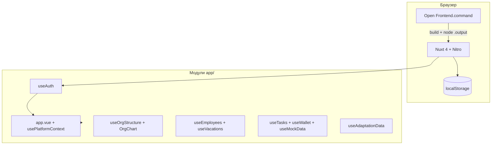

# Архитектура VBI HR Gamification

## Обзор



Приложение — **SPA с SSR**: сервер отдаёт HTML, интерактивность и персистентность на клиенте.

---

## Точка входа и оболочка

### `app/app.vue`

Порядок рендера:

1. `authReady === false` → «Загрузка...»
2. Не авторизован → `AuthLogin.vue`
3. Авторизован → `app-shell` (sidebar + topbar + `<NuxtPage />`) + опционально `WelcomeCelebration`

### `usePlatformContext.ts`

- Роль UI: `employee` | `admin` (не путать с `user.role` в auth).
- Админ с `role: admin` может переключать режим в сайдбаре.
- `guardRoute`: пути `/admin/*` недоступны в режиме сотрудника.

### Плагины (только client)

| Файл | Назначение |
|------|------------|
| `auth.client.ts` | `restoreSession()` при старте |
| `vbi-demo-data.client.ts` | Миграция версии демо, `hydrate()` сотрудников, отпусков, оргструктуры |

---

## Composables

| Composable | Файл | Ответственность |
|------------|------|-----------------|
| `useAuth` | `useAuth.ts` | Логин, сессия, welcome-флаг |
| `usePlatformContext` | `usePlatformContext.ts` | Навигация, режим admin/employee |
| `usePermissions` | `usePermissions.ts` | Подписи ролей, `roleLabel` |
| `useEmployees` | `useEmployees.ts` | Справочник ФИО, руководители, связь с аккаунтами |
| `useVacations` | `useVacations.ts` | Заявки, календарь, согласование |
| `useOrgStructure` | `useOrgStructure.ts` | Директора, отделы, группы, сетка |
| `useTasks` | `useTasks.ts` | Задачи геймификации |
| `useWallet` | `useWallet.ts` | Баланс и транзакции |
| `useMockData` | `useMockData.ts` | Демо-данные дашборда, магазин |
| `useAdaptationData` | `useAdaptationData.ts` | Направления и шаги адаптации |
| `useAdminData` | `useAdminData.ts` | Справочники админки (пользователи, отделы legacy) |

**Правило:** `useState()` только **внутри** функций composable / setup — не на уровне модуля (иначе SSR 500 и вечная «Загрузка...»).

---

## Страницы (`pages/`)

### Сотрудник

- `index.vue` — главная
- `adaptation.vue`
- `organization.vue` → `OrgChart` readonly
- `vacations.vue` — ветвление employee / manager UI
- `tasks.vue`, `store.vue`, `wallet.vue`, `profile.vue`

### Админ

- `admin/index.vue` — хаб ссылок
- `admin/organization.vue` — `OrgChart` + кнопки +директор / +отдел / +группа
- `admin/employees.vue`, `admin/hierarchy.vue`, `admin/vacations.vue`
- `admin/users.vue`, `admin/store.vue`, `admin/adaptation.vue`

---

## Ключевые компоненты

| Компонент | Назначение |
|-----------|------------|
| `OrgChart.vue` | Иерархическая оргсхема, drag на сетке 6 колонок |
| `OrgUnitFields.vue` | Поля отдела (название, руководитель) |
| `OrgConfirmDialog.vue` | Подтверждение удаления |
| `InlineField.vue` | Редактирование текста inline |
| `EmployeeVacationPanel.vue` | Кабинет сотрудника: заявки + календарь |
| `ManagerVacationAside.vue` | Боковая панель руководителя |
| `VacationTeamCalendar.vue` | Команда на год |
| `VacationDetailedCalendar.vue` | Детальный календарь |
| `AuthLogin.vue` | Форма входа |
| `WelcomeCelebration.vue` | Конфетти + «Добро пожаловать» |

---

## Оргструктура (данные)

```ts
OrgExecutive   // id, title, person, order, gridCol, gridRow
OrgUnit        // отдел: executiveId, groupId?, name, head, ...
OrgUnitGroup   // рамка: label, executiveId, gridCol, gridRow
OrgStatsFact   // «VBI в цифрах» (опционально)
```

- `buildPlacedItems()` — порядок отрисовки: группы, затем solo-отделы.
- `snapGridCell()` — привязка drag к ячейкам.
- Storage: **`vbi-org-structure-v1`**.

---

## Отпуска

1. `useEmployees` — кто чей руководитель; `findByUserForAuth()` по `platform_user_id` или email.
2. `useVacations` — заявки, статусы, `canManagerApproveRequest()`.
3. Сид: `data/vacation-seed.json` (год, праздники, демо-заявки).

Референс бизнес-логики: `_vacation_source/График отпусков/`.

---

## localStorage

| Ключ | Composable / модуль |
|------|---------------------|
| `vbi-auth-session` | `useAuth` |
| `vbi-welcomed-users` | `useAuth` (IDs, уже видевших welcome) |
| `vbi-platform-demo-version` | `vbi-demo-data.client.ts` (сейчас `4`) |
| `vbi-employees-v3` | `useEmployees` |
| `vbi-vacations-state-v3` | `useVacations` |
| `vbi-org-structure-v1` | `useOrgStructure` |
| `vbi-tasks-state` | `useTasks` |

Устаревшие ключи сбрасываются при смене `DEMO_PLATFORM_VERSION` (см. `LEGACY_STORAGE_KEYS` в плагине).

---

## Стили

- Единый файл: `app/assets/main.css` (~3500 строк).
- Токены: `--primary: #7c3aed`, фон `--bg: #f4f2ff`, карточки, vacation-layout, org-chart, auth-screen.
- `platform-base.css` — **не используется** в сборке (остаток эксперимента Miro); можно удалить при уборке.

Подключение: `nuxt.config.ts` → `css: ['~/assets/main.css']`.

---

## Сборка и запуск

```
npm run build  →  frontend/.output/server/index.mjs
NITRO_PORT=3300 NITRO_HOST=127.0.0.1 node .output/server/index.mjs
```

`Open Frontend.command` освобождает порты 3000/3300, собирает и открывает браузер.

---

## Backend (план)

Папка `backend/` зарезервирована. В транскрипте разработки упоминался PHP API (wallet, tasks, store) — в текущем коммите **не включён**.

При появлении API:

1. Описать контракт в `docs/API.md`.
2. Заменить `persist()` в composables на `fetch`.
3. Обновить README и CHANGELOG.

---

## Известные ограничения демо

- Нет реальной аутентификации (пароли в коде).
- Данные локальны браузеру.
- Роли `hr` в auth есть, но UI в основном `employee` / `admin` + manager для отпусков.
- `useMockData` и `useTasks` частично дублируют типы с `useWallet` (warning Nuxt duplicated imports — не критично).
