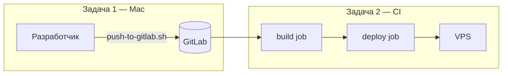

# CI/CD: две задачи

Два независимых контура. **С компьютера на сервер напрямую не деплоим** — только через GitLab.

```
[Mac] ──push──► [GitLab] ──CI/CD──► [VPS 45.12.74.25]
         задача 1          задача 2
```

Подробности сервера: [DEPLOYMENT.md](DEPLOYMENT.md), Beget: [../deploy/SETUP-ILNIZUMAK.md](../deploy/SETUP-ILNIZUMAK.md).

---

## Задача 1. С компьютера → Git

**Кто:** разработчик на Mac.  
**Что:** коммит + push в GitLab.  
**Чего нет:** сборки на сервере, rsync, перезапуска nginx.

### Один раз

```bash
bash deploy/scripts/bootstrap-ssh.sh   # ключ ~/.ssh/vbi_hr_deploy
```

Публичный ключ добавить в GitLab → **Preferences → SSH Keys**  
([ilnizumak.beget.app](https://ilnizumak.beget.app), SSH **порт 2222**).

### Каждый раз после изменений

```bash
cd "/Users/stasamba/Desktop/VBI HR платформа"
git add …
git commit -m "…"
bash scripts/push-to-gitlab.sh          # текущая ветка
# или явно:
bash scripts/push-to-gitlab.sh staging
bash scripts/push-to-gitlab.sh main
```

| Ветка | Куда попадает код | Что запустит CI |
|-------|-------------------|-----------------|
| `staging` | тестовый контур | build → deploy на :8080 |
| `main` | бой | build → deploy (ручная кнопка) |

Проверка push:

```bash
ssh -i ~/.ssh/vbi_hr_deploy -p 2222 -T git@ilnizumak.beget.app
```

---

## Задача 2. Из Git → сервер

**Кто:** GitLab CI (`.gitlab-ci.yml`).  
**Что:** `npm ci` → `nuxt build` → rsync `.output` → `systemctl restart`.  
**Когда:** после push в задаче 1.

### Один раз: переменные CI/CD

Проект → [Settings → CI/CD → Variables](https://ilnizumak.beget.app/vbi/hrplatform/-/settings/ci_cd):

| Variable | Value | Protected | Masked |
|----------|-------|-----------|--------|
| `SSH_PRIVATE_KEY` | содержимое `~/.ssh/vbi_hr_deploy` | ✓ | ✓ |
| `DEPLOY_HOST` | `45.12.74.25` | ✓ | — |
| `DEPLOY_USER` | `deploy` | ✓ | — |

Тип `SSH_PRIVATE_KEY` — **File** (если доступно) или Variable (многострочный PEM/OpenSSH).

### Каждый push

1. Откройте [Pipelines](https://ilnizumak.beget.app/vbi/hrplatform/-/pipelines).
2. **build** — автоматически (зелёный).
3. **deploy**:
   - `staging` — **автоматически** после успешной сборки;
   - `main` — **вручную** (кнопка ▶ у job `deploy:production`).

### Результат на сервере

| Стенд | URL | systemd |
|-------|-----|---------|
| Тест | http://45.12.74.25:8080 | `vbi-hr-staging` |
| Бой | http://45.12.74.25 | `vbi-hr` |

### Стадии pipeline

```yaml
stages:
  - build    # npm ci + nuxt build → артефакт frontend/.output/
  - deploy   # rsync + systemctl restart (только из CI, не с Mac)
```

Файлы: `.gitlab-ci.yml`, `deploy/scripts/deploy-from-ci.sh`, `deploy/scripts/deploy-remote.sh`.

---

## Схема по веткам



---

## Если CI упал

| Job | Частая причина |
|-----|----------------|
| build | ошибка в коде / `npm ci` — смотреть лог job |
| deploy | нет `SSH_PRIVATE_KEY`, неверный `DEPLOY_HOST`, нет ключа у `deploy@сервер` |

Ручная проверка деплоя (экстренно, не основной поток):

```bash
export DEPLOY_HOST=45.12.74.25 DEPLOY_USER=deploy
bash deploy/scripts/build-and-deploy.sh staging
```

Это обход CI — для отладки, не для ежедневной работы.
